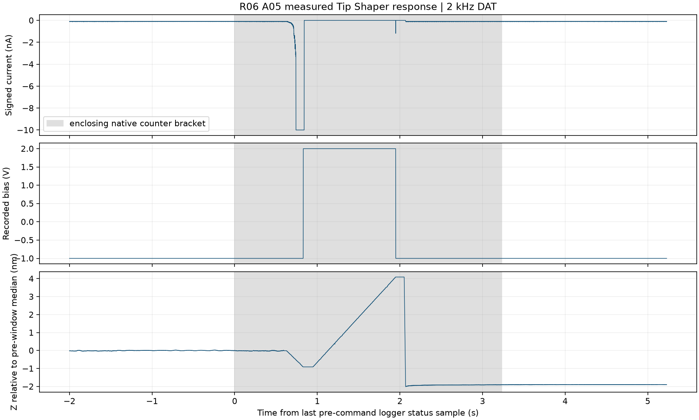
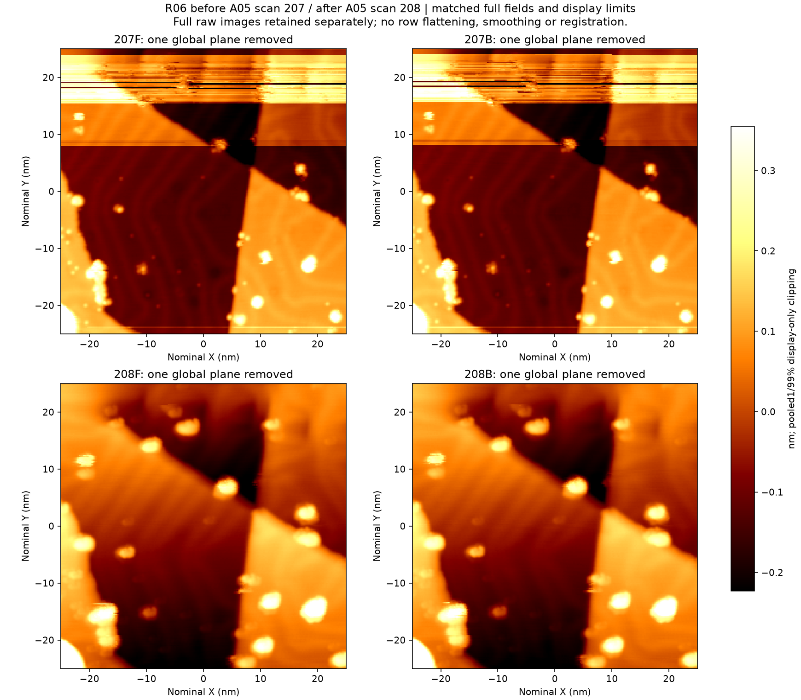

# Au(111) 同区角点整形 A05

## 修前观察和动作理由

207 是这次整形的完整修前图。它与历史图 206 揭示了两种同时存在的变化。207 上部约 Y = +15.5 至 +22.5 nm 的多条横纹横跨台阶，原先能在正反扫辨认的孤立颗粒 C1 在两个方向都失去了完整轮廓，邻近台阶 C3 的上缘也有干扰。稍后扫到的中下部却已有改善，C2 和 D4 在整形前就恢复了清楚的轮廓。全幅内不能持续分辨参照物，单凭这幅图也无法确定针尖在最后一行仍处于同样状态。[修前原始 SXM](./BM261029_00207.sxm) · [206 至 207 的局部正反扫](./figures/206_to_207_before_any_shaping.png)

在预先选定的同区角点做一次整形，检验上部横纹能否减轻、C1 在两向能否重新辨认，同时检查 C2、D4 是否保留。若只有部分图变清或伪影转移到别处，分别记录区域得失。针尖结构变化、局部材料转移和成像中的自发变化都可能贡献观测结果，本次没有独立成分测量。

## 参数与实际执行

| 记录项 | 数值或动作 |
|---|---|
| 样品与成像设置 | Au(111)，中心 (0, 0) nm，50 × 50 nm，240 × 240 像素，向下扫描，正反向各 0.912 s/行。偏压 −1 V，设定电流 100 pA，反馈开启。 |
| 调理位置和配置 | 扫描结束角点 (−25, −25) nm。SafeTip Off。初始偏压 −1 V，程序设定 Tip lift −0.9 nm、首段 0.2 s。随后切换抬升偏压 +2 V，等待 0.1 s，从最低位置上抬 5 nm、历时 1 s，恢复偏压和反馈。 |
| 控制器动作 | 北京时间 11:39:30.625 写入 TipShaper.Start，11:39:33.134 收到等待结束的正常回包。实际 Start 一次，独立电压脉冲零次，原 Tip Shaper 配置在观察 30 s 后恢复并读回。 |
| 固定点慢读取 | 动作前、后各观察约 30 s。各自末约 10 s 的平均电流分别为 −100.03、−99.87 pA，Z 去趋势 RMS 分别为 12.79、2.17 pm，Z 漂移分别为 +1.46、+0.23 pm/s。 |
| 修后扫描启动 | 11:40:11.998，与动作结束相隔 38.86 s。 |

[配置读回](./evidence/configuration_readback.json) · [Start 记录](./evidence/shaper_start.claim) · [结束回包](./evidence/shaper_start_ack.json) · [恢复结果](./evidence/outcome.json)

## 原生轨迹

2 kHz 原生六通道记录中，电流连续 199 个样本（99.5 ms）处于约 −9.99948 nA 的记录边界，真实电流极值未知。前 175 点发生在 −1 V，1 点在过渡电压，后 23 点在 +2 V。+2 V 平台实测 1.119 s，平台首末 Z 变化为 +4.998 nm。以动作前后各 2 s 中位数比较，Z 工作点移动约 −1.897 nm。局部电流与 Z 的强响应以及随后恢复均有记录。绝对针样间距、接触深度及转移物的身份无法由此反推。

[原生波形分段](./evidence/review.json) · [电流触边细节](./evidence/phase_detail.json) · [原生第 52 块](./evidence/dl_goal30_FIVE1102_SESSION_02_R0600052.dat.gz) · [原生第 53 块](./evidence/dl_goal30_FIVE1102_SESSION_02_R0600053.dat.gz)

## 完整修前与修后比较

**上排 207 修前，下排 208 修后。左列正扫，右列反扫。** 每帧仅减去一个整体平面，四幅图共用色标。显示范围由合并数据的第 1 至 99 百分位确定，未做逐行压平、平滑或位移配准。原始数据完整保留。

208 中，207 上部的成片横纹在两个方向都已消失。孤立颗粒 C1 和斜台阶邻近突起恢复了连续外缘，C2 和 D4 保持可辨。多个物体看起来更圆、更宽。当前纳米颗粒与台阶辨识任务已有改善，尚无原子级分辨证据。局部残留短纹和左下作用区域的新形貌单独保留。

独立 C2、D4 在两个扫描方向上均支持向右下的共同位移。二级检查给出约 X +0.83 nm、Y −1.67 nm，模型只用来追踪对应物体；主比较图维持原始坐标。因此不能把旧遮罩内的高度下降解释为物体消失，也不能仅凭色标饱和区比较颗粒宽度。207 后段已经出现自发恢复，单次顺序比较对“改善全部由整形造成”的支持有限。[对应物体的局部正反扫](./figures/207_before_208_after_objects.png) · [位移检查](./evidence/landmark_displacement.json) · [逐项判读](./evidence/post_manual_review.json)

208 原生扫描核心段最负电流约 −0.812 nA，没有达到 1 nA 的采样点。207 核心段有 16 个达到 1 nA 的样本、最负约 −9.325 nA。修后固定点 31.81 s 的电流范围为 −132.7 至 −76.5 pA，三个完整 10 s 窗口的 Z 去趋势 RMS 依次为 3.57、1.71、2.07 pm。这些结果支持电学扰动减少与反馈恢复，图像判定仍以参照物的可辨性为依据。[扫描期与恢复期原生统计](./evidence/after_A05_scan_native_phases.json)

## 独立完整复扫与结论

保持相同参数，11:49:13 至 11:56:32 再扫完整图 209。208 与 209 之间没有额外调理。C1、C3 及 C2、D4 的外缘和台阶关系保持，207 上部的密集横纹没有返回。208 和 209 的正反向高度差去除整体偏移后的 RMS 分别为 14.82、14.57 pm，供一致性比较。[208 与 209 完整正反扫](./figures/208_after_209_confirmation.png) · [209 原始 SXM](./BM261029_00209.sxm)

209 原生扫描核心段最负电流约 −0.433 nA，没有达到 1 nA 的样本。结束后 27.57 s 电流中位约 −99.92 pA，Z 去趋势 RMS 在三个顺序窗口中为 3.13、1.92、2.88 pm。该证据范围包括两个完整修后帧及各自恢复窗口。[209 原生分段记录](./evidence/confirm_A05_scan_native_phases.json)

| 结论标签 | 本次判断 |
|---|---|
| L0 动作执行 | supported。一次 Start、有正常等待结束回包、原生响应及预设恢复。 |
| L1 结状态响应 | supported。同步 I/Bias/Z 有明确变化，动作后恢复。 |
| L2 成像改善 | supported。匹配 207→208 的上部横纹消失、独立轮廓恢复。保留修前自发恢复造成的因果混淆。 |
| L3 当前任务可用 | supported。208 后的一次完整无额外调理复扫 209 保持纳米颗粒和台阶辨识。 |
| L4 化学洁净 | unknown。没有独立成分证据。 |

本次新增一次完整修针尝试，累计 2/5 次完整尝试，原计划还剩 3 次。本次没有主动诱导坏态，完整“可用→主动诱导→明确坏态→修复→持续可用”闭环计数仍为 0。209 可以作为后续独立诱导段的可用起点，后续动作另立记录。

## 数据保存和技能增量

207、208、209 的原生 SXM 分别与 TCP 返回的六幅矩阵逐值核对，每帧 345,600 个 float32 全部一致。完整原生 DataLog 和逐包 TCP 档案保存在本地实验档案。此包提供覆盖这三个完整帧及 A05 的闭块校验清单，并保留动作所在两块原始 DAT 的无损 gzip。R06 在这份快照发布时继续记录，清单没有伪称最终停止状态。[原生文件索引](./native_index.json)

Skill 只增补本次实际用到的时间序列判图方法。按采集先后记录各参照的失真和恢复，将修前已恢复的对象列为修后需保持对象，检查失真有无转移。原有其余流程保持原版本，本轮未采用的脉冲、1 nA 准备、反馈时间常数调整和换区方法继续记录为未用。图中个案波动数值和触边持续时间留在本报告。
