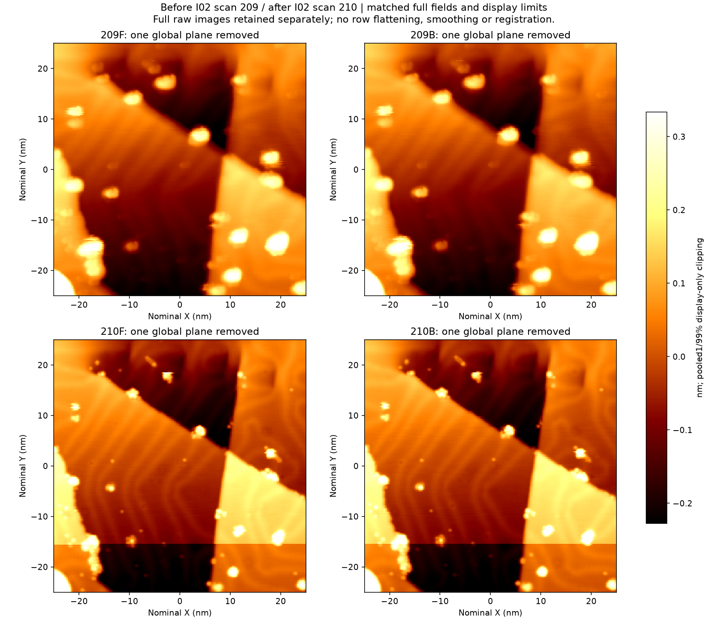

# Au(111) I02 同区角点诱导尝试

**完整图 210 仍可用于本轮纳米颗粒和台阶辨识。I02 未建立明确坏态，修针次数保持 2/5。**

以前一修复段无额外调理确认图 209 为可用起点，2026 年 11 月 3 日在同一区域角点 (−25, −25) nm 执行一次独立诱导。名义接近 −0.9 nm、0.2 s，随后 +2 V 抬升偏压及 5 nm/1 s 回撤，−1 V/100 pA 起始条件，SafeTip Off。12:00:33.899 发送 Start，12:00:36.427 正常结束，30 s 后原配置恢复。该配方允许尖端或局部表面重排及材料交换，作用方向需要实测判断。[动作记录](./evidence/outcome.json) · [配置读回](./evidence/configuration_readback.json)

## 完整图判断

上排 209 诱导前，下排 210 诱导后。左列正扫，右列反扫，每帧仅去除整体平面并共用显示色标。参照物 C1、C2、C3、D4 均能辨认，多数对象更紧凑。C1 正扫的单行亮突刺、D4 的短横尾以及 Y 约 −15.4 nm 的一条背景阶跃作为局部限制保留，当前没有分散目标整体失去辨识功能的证据。

C1 两向的半高连接体表观横向包围宽由约 3.54 nm 变为 1.88 nm；该量描述图像响应，包含采样、背景和尖端因素。正反扫去均值差 RMS 由 14.57 增至 19.21 pm，但逐目标轮廓仍可辨，因此未以单项 RMS 上升判坏。[逐目标判读](./evidence/post_manual_review.json) · [原始 210](./BM261029_00210.sxm) · [此前 209 原始图](../au111_A05_20261103/BM261029_00209.sxm)

## 动作及恢复过程

2 kHz 原生记录中，动作外包窗的 Z 相对修前中位数约 −0.899 至 +4.101 nm，+2 V 平台持续 1.136 s。有一段连续 688.5 ms 的电流绝对值达到 4 nA，包含正负记录量程边缘，实际峰值未知。

恢复期也有时间结构。首个 10 s 的 Z 去趋势 RMS 为 3.78 pm，中间 10 s 为 81.56 pm，末 9.46 s 为 1.69 pm。约第 12.29 s 出现工作点变化，随后再次稳定；末约 10 s 慢读 RMS 为 1.78 pm。全窗统计和末端恢复分开保留。[原生分段](./evidence/I02_native_pre_action_post.json) · [固定恢复窗](./evidence/I02_recovery_windows.json) · [动作原始 DAT](./evidence/dl_goal30_FIVE1102_SESSION_02_R0600154.dat.gz)

完整扫描 210 中有两组较大短瞬态，其中一组 3 个点达到 4 nA，含一个负量程边缘点。两组事件首点后 5–500 ms 均未再出现 400 pA 以上样本，25–100 ms 电流中位约 −99 pA。扫描中 Z 同时含地形和反馈响应。结束后 121.79 s 没有达到 400 pA 的样本，初始固定点恢复后，连续 10 s 窗的 Z RMS 约 1.68–3.31 pm。[扫描与后置恢复](./evidence/after_I02_scan_native_phases.json) · [峰邻域](./evidence/peak_neighborhoods_210.json)

## 记录含义

本次有一次已执行诱导和完整结果图，效果为保持可用。尚无新的坏态，因此未建立新修复 episode，也未重置历史 3 次脉冲。A05 的修复 Start 及本次 I02 的诱导 Start 分别计数。不能把同一次动作重新标成一次成功修复来凑足五次。

下一假设可针对当前图可定位的独立凸起研究一次相互作用，并保留远处参照。凸起成分未知；恒流反馈会跟随形貌抬升 Z，几何上更高不意味着相同名义接近量造成更深接触。后续实验单独冻结参数和判断依据。
