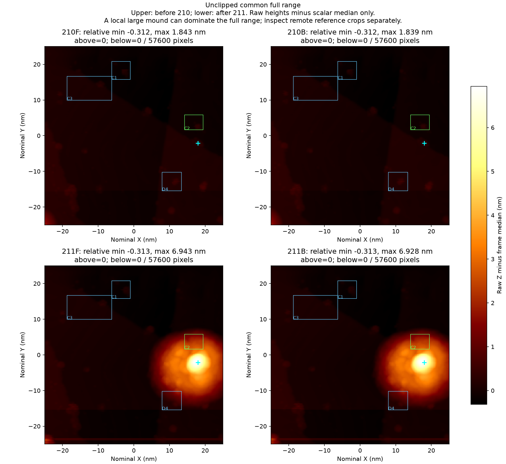
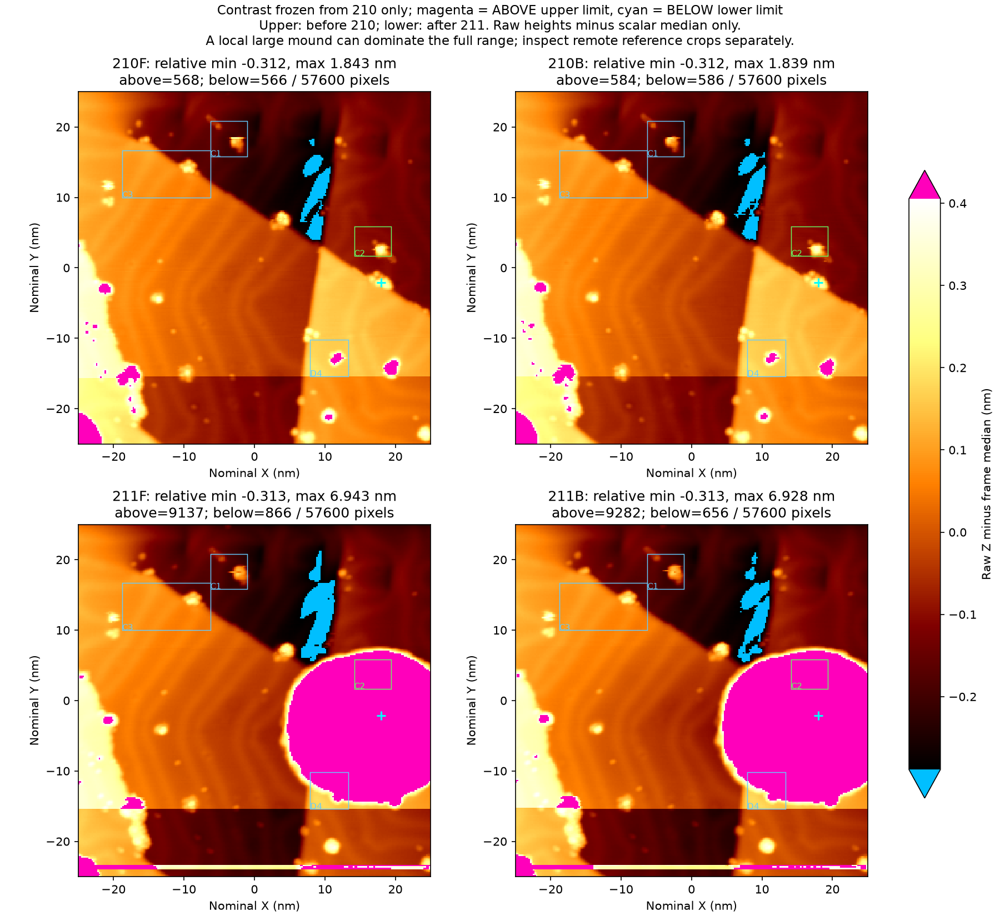
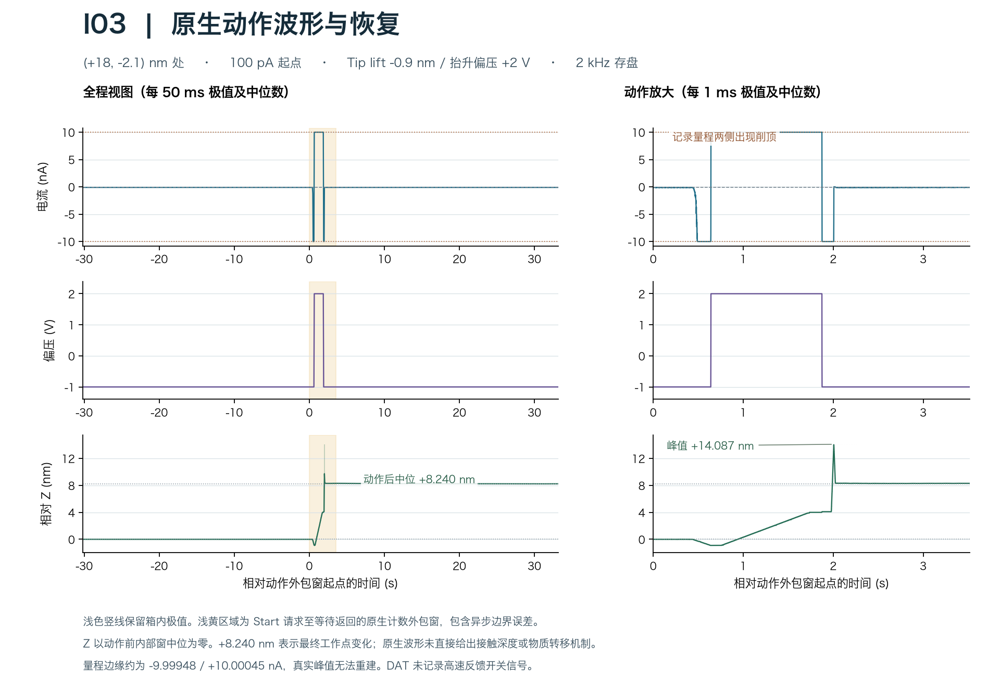

# Au(111) I03 同区凸起相互作用与完整图 211

**一次移动和一次整形后，目标附近形成大幅局部表观隆起，远处纳米突起和台阶仍可辨。全局坏针状态尚待验证，本段新增完整“弄脏—修复—干净”循环为 0。**

本包记录 2026 年 11 月 3 日的 I03 诱导尝试，起点为完整可用图 210，结果为完整图 211。两帧均为同中心、零角度、50 × 50 nm、240 × 240 像素、向下扫描，−1 V / 100 pA、0.912 s/方向行，SafeTip Off。211 的全部六个通道/方向面共 345600 个 float32 值与原生 SXM 逐位一致。[原始 210](../au111_I02_20261103/BM261029_00210.sxm) · [原始 211](./BM261029_00211.sxm) · [完整性记录](./evidence/scan211_quality_report.json)

## 目标与操作

210 正反扫在 (+18, −2.1) nm 附近显示可定位的台阶邻近不对称凸起，成分未知。前一次角点诱导后成像保持可用，本次转而检验一次局部凸起相互作用能否改变尖端或表面。目标与 C1/C3/D4 原参考框分开，邻近 C2 事先列为局部影响检查。

目检后，开发模板中的“孤立凸起”在**执行前**修正为“可分辨凸起”（`resolved_protrusion_supported`）。最终映射时间早于实际移动，目标范围、未知材料及定位误差均已记录。[目标映射](./evidence/induction_R06_I03_target_mapping.json) · [字段修正说明](./evidence/mapping_metadata_review.json) · [目标正反扫](./figures/target_candidates_210_FB.png)

| 事件（北京时间） | 实际参数与结果 |
|---|---|
| 12时16分24.783秒 移动 | 从 (−25, −25) nm 到 (+18, −2.1) nm，名义直线距离 48.718 nm，速度 2 nm/s。到位后连续观察约 5.14 s，恢复原速度配置。高速 XY 未采集，真实插值路径未验证。 |
| 12时18分39.028秒 整形 Start | −1 V / 100 pA 起点，名义接近 −0.9 nm / 0.2 s，抬升偏压 +2 V，底部起算回撤 +5 nm / 1 s。反馈重接前名义净位移 +4.1 nm，接触深度未测。 |
| 12时18分41.646秒 已知结束 | 单次 Start 返回正常 ACK，随后观察 30 s，并恢复原 Tip Shaper 预设。 |
| 12时21分36.300秒—12时28分55.127秒 完整后扫 | 211 原生完成，约 438.825 s。扫描起点定位由原生扫描程序执行，与独立慢速移动分开记录。 |

全过程包含移动到位、单次整形、恢复和完整后扫四个阶段。[移动结果](./evidence/move_outcome.json) · [整形配置读回](./evidence/configuration_readback.json) · [整形结果](./evidence/outcome.json) · [后扫结果](./evidence/scan211_outcome.json)

## 图像判断

下面均为**上排诱导前 210、下排诱导后 211，左正扫、右反扫**。每帧仅减去一个整帧高度中位数，保留原始像素位置和逐行变化。完整共同色阶覆盖全部像素。211 最大相对高度正扫 6.943 nm、反扫 6.928 nm，大丘使远处小颗粒在此色阶下较暗。

第二幅沿用 210 冻结的台阶尺度 −0.289～+0.405 nm，**洋红标出超上限像素，青色标出低于下限像素**，用于检查大丘以外的成像功能。211 超上限分别为 9137、9282 像素。颜色只表示高度显示范围，原始数据完整保留，电流量程事件另行统计。[色阶记录](./evidence/dynamic_range_display_record.json)

C1 的主体及上方小突起在两向仍可辨，主体略宽。正扫有局部短横线，反扫主体连续。C3 斜台阶及邻近凸起两向均清楚，共同约 (+0.42, +0.21) nm 的名义位移能解释部分位置差。位移分析独立保存，图像保持原位。其他远处对象也保持分散可辨，支持本帧远端成像功能仍可用。

C2 事先列为局部检查。D4 原先列为独立参考，211 的大丘边坡已侵入其窗口，当前应按受影响区域解释。原前瞻计划、包含 D4 的量值及只看 C1/C3 的次要位移分析均保留。末端 Y 约 −23.3～−24.0 nm 的短跨行背景偏移和 C1 短横线仍是本帧局限，长期稳定性需要后续验证。[逐目标正反扫对比](./figures/objects_before_top_after_bottom.png) · [前瞻计划](./evidence/prospective_image_review_plan.json) · [正式判读](./evidence/post_manual_review.json)

## 原生电学与解释范围

2 kHz 原生记录显示，动作外包窗中 Z 相对修前中位数最低约 −0.904 nm。偏压回到 −1 V 后出现约 +14.087 nm 的瞬态 Z 峰，动作后固定点中位约 +8.240 nm。+2 V 平台约 1.234 s，电流记录在正、负量程边缘均出现截顶，真实模拟峰值无法重建。末约 10 s 慢读电流 −104.03 pA，Z 去趋势 RMS 4.08 pm。**+8.24 nm 记录固定点工作点变化，接触深度与材料转移量未测。**

扫描 211 的最负原生样本约 −9.998264 nA，接近既往 −9.9994768 nA 记录边界，当前归为近负轨样本，削顶尚未证实。该短事件组在原生时间 3609.188 s 开始，关联到末端慢扫 **Y 约 −24.38～−24.30 nm、零基行约 236–237**，与大丘中心 Y≈−2.1 nm 分处不同慢轴区域。此定位依据异步计数器和主机慢轴读回，具体同步像素、X 和扫向未确定。峰后 100–250 ms 电流中位约 −98.9 pA，已封存的后置 47.61 s 电流约 −99.67±1.28 pA。[峰邻域](./evidence/peak_neighborhoods_211.json) · [行级定位及误差](./evidence/211_peak_slow_axis.json) · [全扫描与恢复](./evidence/after_I03_scan_native_phases.json)

当前观察支持“局部大丘 + 远端仍可用”。可能贡献包括局部表面重排、材料交换、尖端结构变化、反馈重新平衡、电子学表观和漂移。目标物成分及具体原子转移路径尚不明确，移动与整形的贡献也需要中间完整图才能分别评价。本段保留这些因果备选，坏态建立和修复成功均尚待证据。

本次诱导 Start 独立计数，历史脉冲和 A05/I02 记录保持原计数，已完成修复循环增量为 0。原始 211、选取的原生动作块 238–243 及峰所在块 289 均保留原始字节，DAT 使用无损 gzip 封装。[来源索引](./source_index.json) · [文件摘要清单](./manifest.json)
