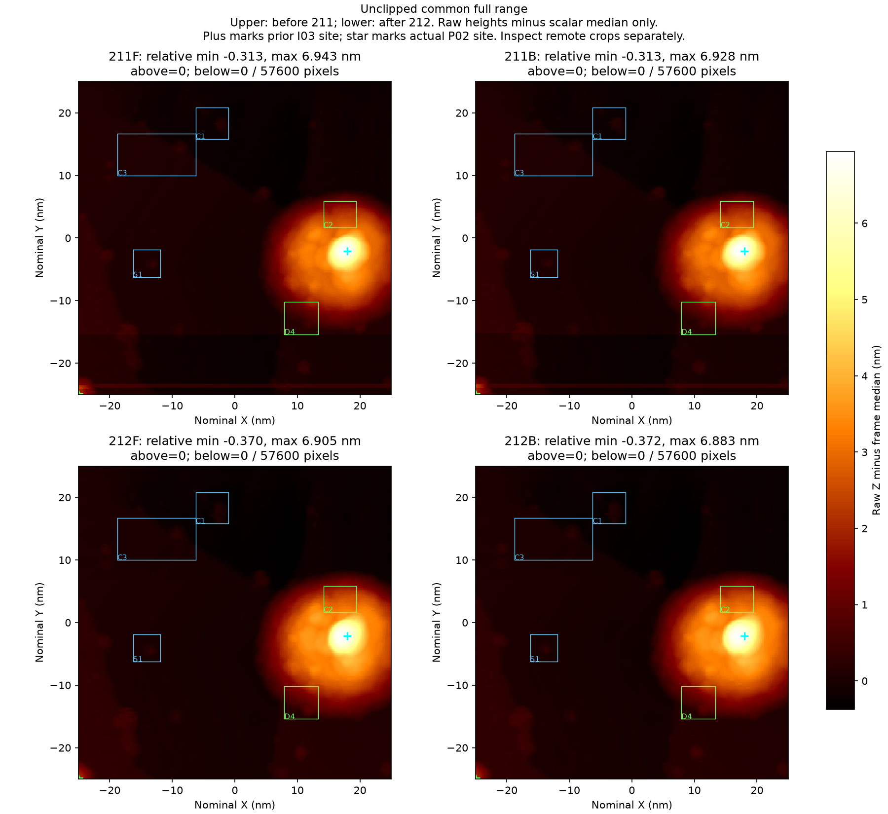
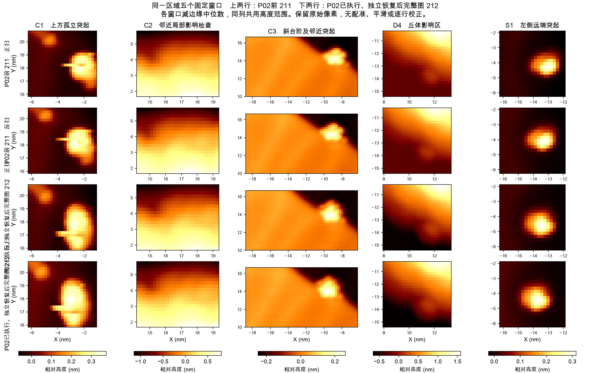
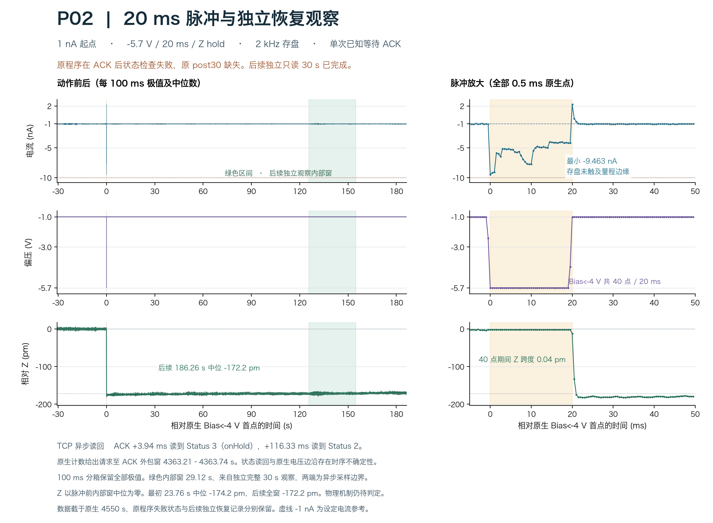

# P02 单次脉冲、独立恢复与完整图 212

样品为 Au(111)，针尖基材未确认。本轮未取得新鲜温度读数，SXM 中的历史温度注释仅作历史信息。实际动作通过已核验的 Nanonis TCP 适配器执行，RustDesk 用于界面核对。

本包记录 Au(111) 同一区域的一次诱导尝试。准备电流升至 1 nA，在角点执行一次 −5.7 V、20 ms、Z hold 脉冲。脉冲等待回包已知成功，原程序随即在反馈状态检查处中止。随后另立只读恢复观察和 11 步返回 100 pA，完成匹配条件的完整图 212。

**完整图 212 保留当前纳米对象与台阶辨识能力，尚未证实诱导出任务相关坏态。** C1 局部形状发生变化，右侧 I03 大丘持续存在，部分区域的精确形貌仍受限。本次诱导未增加修复闭环计数。[正式图像审查](evidence/image_review/post_manual_review.json)

## 当前计数与结论范围

| 项目 | 本次截面 |
|---|---|
| 同一连续历史的脉冲预算 | 已使用 4 / 6 次，P02 为第 4 次 |
| 用户要求的完整修复尝试 | 当前累计 2 / 5，P02 归为独立诱导尝试 |
| 严格诱导坏态—修复—恢复闭环 | 0 |
| 本次已知执行 | 一次 P02 脉冲，11 步准备，另一次独立 11 步返回 |
| 当前成像任务 | 完整图 212 的纳米对象与台阶辨识可用，保留局部限制 |
| 持续可用性 | 本截面尚无 P02 后无额外调理的独立复扫 |
| 化学洁净或物质转移机制 | 未验证 |

原脉冲结果持续保留为 `uncertain_or_recovery_failed`，错误为 `Not known On2/allidle`。原程序的 post30 没有执行。后来的独立只读 30 秒和独立返回分别有新记录，不能补写成原 post30 成功。[脉冲原始结果](evidence/stages/pulse_induction_P02/outcome.json) · [独立观察](evidence/independent_readonly30/outcome.json) · [独立返回](evidence/stages/recovery_return_P02_01/outcome.json)

## 同区域完整图

下图上排为 P02 前的完整图 211，下排为独立恢复后的完整图 212。左列为正扫，右列为反扫。使用共同完整高度范围，保留全部 240 × 240 像素。右侧大丘占据约 7 nm 的动态范围，远端小对象需结合下一组局部图查看。星号为实际 P02 角点，十字为此前 I03 位置。[显示与处理记录](evidence/image_review/dynamic_range_display_record.json)



下图前两行为图 211 的正扫、反扫，后两行为图 212 的正扫、反扫。各列采用同一显示范围，减去各窗口边缘的标量中位数，保留原始像素。主图未进行空间配准、平滑或逐行校正。[数值比较](evidence/image_review/image_measurements.json)



- C1 原上方小点与主体仍可区分。212 主体沿低 Y 方向拉长，并出现下肩或瓣及短横线，局部精确轮廓判读受限。
- C3 斜台阶在两向仍连续，邻近对象略宽。S1 和分散突起保持可分辨。
- C2 与 D4 仍处于此前 I03 大丘影响范围，它们的独立参照角色在 P02 前已经排除。
- 多个地标出现约 −0.42 nm 的共同 X、Y 位移。共同位移敏感性核查支持部分定位差异，C1 的全部形变仍有未排除解释。
- 本次完整正反扫尚未识别跨这些对象的一致复制向量，远端任务功能保留。局部形变的针尖、真实样品形貌与反馈贡献尚未分开。[正式判据与限制](evidence/image_review/post_manual_review.json) · [位移敏感性核查](evidence/image_review/landmark_displacement.json)

补充远端扩大窗口属于后验描述。它保留原冻结参考和原图像判据。[补充视图](figures/exploratory_remote_shapes.png) · [补充记录](evidence/image_review/exploratory_remote_shapes.json)

## 实际操作链

以下时间为北京时间 2026-11-03。准备、脉冲、独立观察、返回电流构成复合干预，图像变化的单一机制仍需进一步证据。

| 阶段 | 实际参数与过程 | 实际结果 |
|---|---|---|
| 完整前图 | 211，−1 V、100 pA，50 × 50 nm，240 × 240，0.912 s / 方向，向下扫描 | 远端任务可用，局部大丘和参照限制已记录 |
| 电流准备 | 12 时 37 分至 39 分，角点固定，100 pA 逐级到 1 nA | 11 次 SetpntSet 均有原始线码、ACK 和精确读回，末尾 30 秒观察完成 |
| 单次脉冲 | 12 时 41 分 24 秒，−5.7 V、20 ms、Hold，固定角点 | 等待 ACK 已知，约 3.94 ms 后 StatusGet 读到 3，触发原 On2 检查失败 |
| 后续状态读回 | ACK 后约 116.33 ms | StatusGet 读到 2，OnOffGet 均为 1，各字段依次读取 |
| 独立只读恢复 | 12 时 43 分另立 30.0416 秒观察 | 57 次完整快照均通过原 1 nA 状态检查，未发送写命令 |
| 独立返回 | 12 时 47 分至 49 分，1 nA 逐级返回 100 pA | 新事件和一次性记录，11 次 ACK，完整最终 30 秒观察和原生恢复核查 |
| 完整后图 | 12 时 51 分 04.842 秒启动，12 时 58 分 23.626 秒已知扫描完成 | 438.783 秒完整帧，原生 SXM 与 TCP 数组核对一致，完整正反扫已判读 |

原始事件、各级目标、ACK、最终观察及执行源版本分别保存。[五阶段电学摘要](evidence/native_audits/P02_electrical_stages_through212.json) · [准备记录](evidence/stages/prepare_induction_P02/manifest.json) · [返回记录](evidence/stages/recovery_return_P02_01/manifest.json) · [完整后扫记录](evidence/scan212/manifest.json)

## 脉冲与恢复波形

原生存盘间隔为 0.5 ms。左侧展示每 100 ms 内全部样点的极值和中位数，右侧保留全部原生脉冲点。绿色为后续独立观察对应的原生内部窗口，两端排除异步计数边界。



- Bias 小于 −4 V 的区间有 40 个样点，对应 20 ms。最小电流为 −9.463 nA，存盘样点未触及已记录量程边缘。40 点期间 Z 跨度约 0.04 pm，与 Hold 状态相符。
- 原程序 ACK 后第一次状态读回为 `on Hold`，随后为 `On`。TCP 字段和原生波形之间保留异步时间误差，不能把两次状态读回间隔直接当作实际 Hold 释放时长。
- 以脉冲前内部窗为参照，最初 23.76 秒 Z 中位变化为 −174.2 pm，后续 186.26 秒整体中位变化为 −172.2 pm。这些数值描述工作点变化，尚未说明转移的材料、方向或原子数量。
- 原始程序失败结果和随后独立观察各自保留。存盘采样与带宽限制仍存在，样点最值只描述已记录信号。[脉冲原生审查](evidence/native_audits/P02_actual_pulse_and_native_recovery.json) · [延伸恢复](evidence/native_audits/P02_native_recovery_through364.json) · [状态线码核查](evidence/native_audits/P02_status_transition_review.json)

独立返回的各级内部窗口均在对应设定电流的 ±20% 范围内。末尾原生内部窗为 29.23 秒，电流 −111.65 至 −89.37 pA，Z 去趋势 RMS 为 1.36 pm。随后 28.91 秒电流 −109.34 至 −90.51 pA，Z RMS 为 1.24 pm。[返回全程](evidence/native_audits/P02_independent_return_native_phases.json) · [返回后原生记录 v2](evidence/native_audits/P02_independent_return_postroll_v2.json)

## 完整扫描的电学证据

图 212 的原生扫描核心覆盖 437.96 秒。最小电流为 −1.793 nA，没有绝对值达到 4 nA 的存盘样点。绝对值达到 1 nA 的 29 个样点分为 15 组，最长组为 2 ms。达到 400 pA 的 466 个样点分为 122 组，最长组为 14.5 ms。

其中 10 个较强事件组位于名义行 128–133，与 I03 大丘的慢轴带重合。其他 5 组位于行 187–193。这里仅有行级同步，无法确定快轴像素、正反方向或唯一机制。扫描结束后的首 10 秒仍有 Z 调整，后续两窗 Z RMS 约 4.95 和 5.17 pm，电流恢复。[完整 2 kHz 扫描核查](evidence/native_audits/after_P02_recovery_scan_native_phases.json) · [事件邻域](evidence/native_audits/peak_neighborhoods_212.json) · [行级定位](evidence/native_audits/212_peak_slow_axis.json)

这些电学描述用于定位与恢复审查。任务功能结论使用前述完整图像证据。

## 实践记录与定位订正

本次保留了已知 ACK、瞬态 Hold 读回、原检查失败、独立只读恢复及独立返回的完整区分。可据此进一步评估等待结束后的有限只读状态观察流程。本单例没有给出通用等待时间或物理保护阈值。本包没有修改 Skill，实际使用与引用后未使用的部分另表保存。[实践记录](evidence/native_audits/P02_skill_practice_observation.json)

返回后的局部数组审查最初漏加了原生块号偏移，影响 `minimum_I_location.block` 的 4 个定位字段。原始 JSON 保留，新 v2 把局部块号换算为 R06 全局块号。递归比对确认其他数值、时间窗和结论一致。[订正记录](evidence/native_audits/P02_location_erratum.json)

## 数据范围与核验

本包冻结于 R06 已关闭原生块 1–433，共 10,825,000 行、5412.5 秒、935,116,777 字节。本截面记录器仍在运行，终态封存待后续单独记录。

发布 43 个 gzip 原生块，包括准备全程、脉冲前后与独立恢复、独立返回全程、扫描峰值带和扫描结束后的观察。其余原生 DAT 保存在本地，其全部索引和 SHA 位于冻结回执。两张完整原生 SXM 均随包提供。57 次只读快照及事件日志、全部动作日志和实际写命令线码均有保存。采集器日志提供经过原前缀 SHA 核验的 DataLog 状态行和真实 Start 记录。[覆盖清单](coverage.json) · [原始来源索引](source_index.json) · [完整冻结回执](evidence/root_and_receipts/post212_native_receipt.json)

执行源用于版本审计，保留其原本机依赖和已核验入口引用。包内校验脚本可离线检查文件集合、所有载荷 SHA、嵌套 manifest 文件和原生 gzip 解压后的 SHA。

```bash
python3 verify_package.py
```
