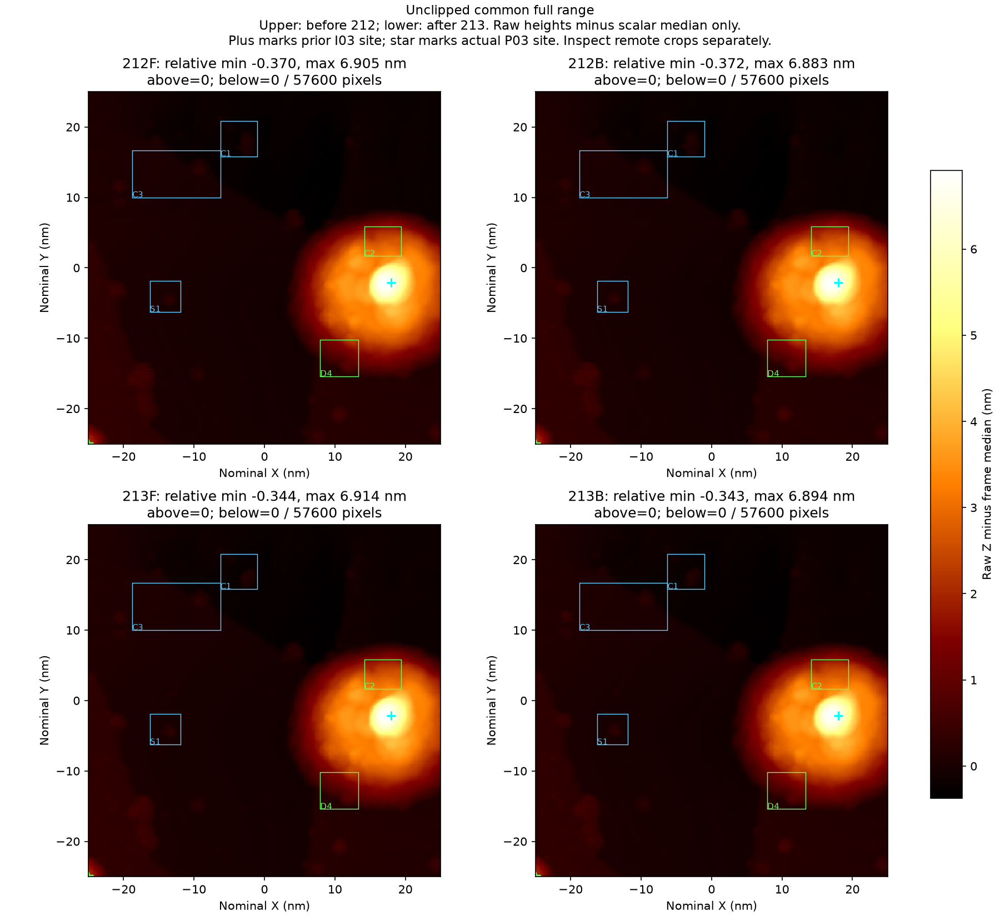
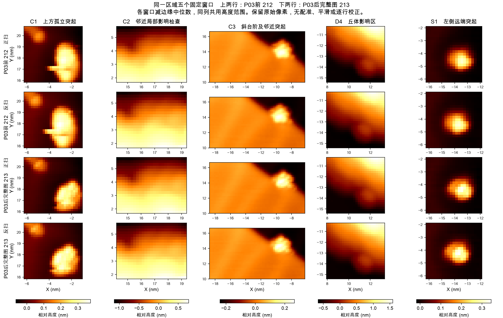
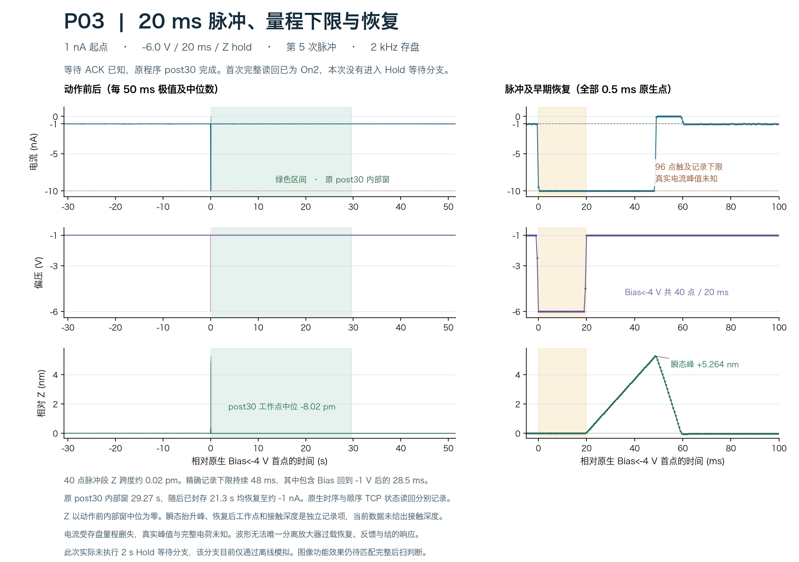
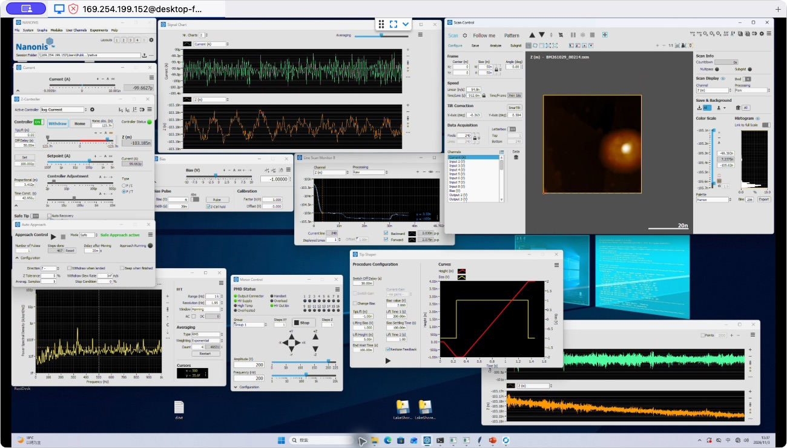

# P03 单次脉冲、完整图 213 与 R06 终态封存

样品为 Au(111)，针尖基材未确认。本轮未取得新鲜温度读数，SXM 中的历史温度注释仅作历史信息。实际动作通过已核验的 Nanonis TCP 适配器执行，RustDesk 用于界面核对。

**完整图 213 保留当前分散纳米对象与台阶边缘的辨识能力，本轮尚未证实诱导出任务相关坏态。** C1 内部形状有变化，旧 I03 局部大丘仍约 7 nm 高。操作人员在第 5 次共享脉冲后结束本段，保留第 6 次预算，等待更可复现的诱导方法。[正式图像判读](evidence/image_review/post_manual_review.json) · [结束决定](evidence/root_and_receipts/root_stop_after213_decision.json)

## 本轮修复工作与当前进度

这次继续实验中的实际修复为完整修前图 207、一次 A05 Tip Shaper、完整修后图 208，再作同条件独立确认图 209。A05 的完整过程已单独发布。其后，为取得可验证的坏态，依次进行了两次机械诱导 I02、I03，以及两次脉冲诱导 P02、P03。[A05 修复报告](../au111_A05_20261103/README.md) · [I02 诱导](../au111_I02_20261103/README.md) · [I03 诱导](../au111_I03_20261103/README.md) · [P02 脉冲与独立恢复](../au111_P02_20261103/README.md)

I03 在实际目标附近留下约 7–8 nm 表观大丘，动作后的 Z 工作点也发生较大变化。该局部结果持续影响 C2、D4 及整帧显示动态范围。材料转移方向、化学成分与有效尖端结构尚未确定。此前与当前远端图像仍保留任务功能，所以这些诱导没有建立新的严格修复闭环。

| 项目 | 截至完整图 213 与终态封存 |
|---|---|
| 用户要求的完整修复尝试 | 累计 2 / 5，尚余 3 次 |
| 严格诱导坏态—修复—恢复闭环 | 0 |
| 同一连续历史共享脉冲 | 已使用 5 / 6，P03 为第 5 次 |
| P03 的身份 | 独立诱导尝试，新增修复尝试计数 0 |
| 当前任务 | 完整图中的纳米对象与台阶边缘辨识可用 |
| 结论层级 | L0、L1 支持，L2 不支持，L3、L4 未知，沿用正式审查中的定义 |
| 持续可用性与化学状态 | P03 后尚无额外独立复扫，化学洁净程度未验证 |

## 同区域完整图与判断依据

前图为完整图 212，后图为完整图 213。两图采用 −1 V、100 pA、50 × 50 nm、240 × 240 像素、向下扫描，单方向行时间为 0.912 s，速度约 54.8246 nm/s，反馈配置相同。后图六个数据面共 345600 个 float32 数值与原生 SXM 逐位匹配。[完整后图元数据](evidence/scan213/manifest.json) · [原生核对](evidence/scan213/analysis/quality_report.json)

下图上排为脉冲前 212，下排为脉冲后 213。左列正扫，右列反扫。共同完整高度范围包含全部像素，十字为此前 I03 位置，星号为实际脉冲角点。旧丘体使远端小对象在整帧显示中较暗，需要同时查看固定窗口。[显示记录](evidence/image_review/dynamic_range_display_record.json)



下图前两行为 212 的正扫与反扫，后两行为 213 的正扫与反扫。各列共用颜色范围，只减去各窗口边缘的标量中位数，保留原始像素、坐标和固定 ROI。[冻结图像判据](evidence/image_review/prospective_image_review_plan.json)



| 参照 | 实际看到的变化 | 对当前任务的判断 |
|---|---|---|
| C1 主参照 | 上方小点与主体仍分开。主体原纵向拖尾和短横线减弱，内部呈斜向双肩或分瓣 | 对象辨识保留，内部精确形貌与双肩成因未确定 |
| C3 主参照 | 斜台阶两向连续，近边突起可辨，轮廓与 212 大体一致 | 台阶追踪和近边对象辨识保留 |
| S1 补充参照 | 两向仍为与背景分开的紧凑突起 | 支持远端成像功能保留 |
| C2 与 D4 | 持续受旧 I03 丘体边坡影响 | 保留局部变化记录，延续既定的参照限制 |
| 完整场 | 分散对象可追踪，尚未识别跨对象一致复制或新增大面积持续刮花 | 当前任务可用，本轮诱导坏态未成立 |

C1 的外观改变与针尖响应变化相容，真实样品形貌、反馈和漂移也可能参与。现有证据不能确定有效尖端数量、吸附原子数量或材料。共同位移敏感性核查支持部分定位差异，最佳位移为 X 加一像素约 0.208 nm、Y 零像素，平均相关性由 0.9246 升至 0.9318。主要比较图保持原始坐标。[位移核查](evidence/image_review/landmark_displacement.json) · [正式判断及限制](evidence/image_review/post_manual_review.json)

台阶尺度显示沿用此前冻结的 210 色阶，洋红和青色分别标出显示上、下限外的像素。213 原始高度减整帧中位数后的最大值为正扫 6.914 nm、反扫 6.894 nm，描述表观形貌与显示范围。[冻结尺度图](figures/frozen_210_contrast_marked_clipping.png)

## 实际操作链与行为依据

以下为北京时间 2026-11-03。以当前可用图 212 为起点，准备电流增加到 1 nA，沿已核准的有限参数阶梯从 P02 的 −5.7 V 增至 −6.0 V。20 ms 脉宽和 Hold 设置保留。此动作旨在继续探索能否产生可验证的新坏态，结果由实际图像判断。准备、脉冲、观察、返回构成复合干预，单独脉冲的贡献仍未分离。

| 阶段 | 实际参数及时间 | 已记录结果 |
|---|---|---|
| 前图 212 | −1 V、100 pA，完整正反扫 | 任务可用，C1 局部形状与旧丘体限制已冻结 |
| 电流准备 | 13 时 12 分至 13 时 13 分 53.122 秒，固定角点约 −25、−25 nm，100 pA → 1 nA | 11 次设定写入、ACK、精确读回，完整最终观察 |
| 单次 P03 脉冲 | 13 时 16 分 21.357 秒已知 ACK，−6.0 V、20 ms、Hold、1 nA | 共享序号 5，原生偏压段 40 个样点 |
| 反馈与原 post30 | 首次完整快照在 ACK 后 107.614 ms 为 On2 | 原 post30 完成，实际 Hold 继续等待分支未执行 |
| 正常返回 | 13 时 19 分至 13 时 21 分 15.820 秒，1 nA → 100 pA | 11 次递减写入、ACK、精确读回，完整最终 30 秒观察 |
| 完整后图 213 | 13 时 24 分 16.843 秒启动，13 时 31 分 35.646 秒已知完成 | 全帧及六个数据面归档，完整正反扫判读完成 |
| 终态封存 | 13 时 36 分 41 秒记录停止 | 原生 615 块含末块完整归档，两次独立停止读回一致 |

准备的 11 级目标约为 125、156.25、195.31、244.14、305.18、381.47、476.84、596.05、745.06、931.32、1000 pA。返回按已冻结的 11 级递减目标执行。原始浮点目标、每级命令线码与 ACK 均留存。[准备原生分段](evidence/native_audits/P03_prepare_native_phases.json) · [脉冲原结果](evidence/stages/pulse_induction_P03/outcome.json) · [返回原生分段](evidence/native_audits/P03_return_native_phases.json)

P02 曾在已知 ACK 后第一次状态读回为 Hold，触发原程序检查失败，原 post30 未执行。之后的 57 次独立只读观察和独立 11 步返回各有新记录。P03 采用已知 ACK 后最多 2 s 的有限只读就绪观察，2 s 为工程期限。这次首次完整快照已为 On2，Hold 继续等待分支仍只有离线模拟覆盖。[P02 原失败](evidence/prior_P02/original_failed_pulse_outcome.json) · [P02 独立观察](evidence/prior_P02/independent_readonly30_outcome.json) · [P02 独立返回](evidence/prior_P02/independent_return_outcome.json) · [P03 实际就绪记录](evidence/stages/pulse_induction_P03/feedback_readiness.json)

## 2 kHz 脉冲波形与恢复

左侧以 50 ms 分箱显示每箱全部样点的最小、最大和中位数，覆盖脉冲前 30 秒、原 post30 及后续已关闭窗口。右侧保留全部 0.5 ms 原生样点，展示脉冲和紧邻恢复。



- 偏压小于 −4 V 的段共 40 点、20 ms，其中 39 点记录在约 −9.99948 nA 量程边界。包含偏压返回后的触边段共 96 点、48 ms。真实峰值及完整电荷存在删失。
- 20 ms 偏压段内 Z 跨度约 0.02 pm。偏压回到 −1 V 后，电流触边继续约 28.5 ms，Z 短暂抬升约 5.264 nm。电子学饱和恢复、反馈与结响应的贡献尚未分开。
- 原 post30 对应的原生内部窗为 29.27 s，两端排除了异步计数边界。该窗电流为 −1087.26 至 −928.01 pA，Z 去趋势 RMS 约 0.679 pm，Z 中位工作点相对脉冲前变化约 −8.02 pm。
- Z 瞬态和稳定工作点变化分别记录。实际接触深度、持久换尖与化学转移尚未测定。[脉冲前后原生核查](evidence/native_audits/P03_native_pre_pulse_post.json) · [逐边沿时序](evidence/native_audits/P03_pulse_transition_timeline.json) · [后续窗口](evidence/native_audits/P03_pulse_postroll.json)

准备与返回各级稳定内部窗均在对应目标的 ±20% 范围内。返回的最终原生内部窗为 29.47 s，电流 −106.69 至 −93.84 pA，Z 去趋势 RMS 约 0.614 pm。[准备后记录](evidence/native_audits/P03_prepare_postroll.json) · [完整返回](evidence/native_audits/P03_return_native_phases.json)

## 阶段间隔、完整后扫与最后观察

所有阶段间隔均单独核对，包含 212 结束到 P03 准备的 833.76 s、准备结束到脉冲前观察的 117.36 s、脉冲后观察结束到返回开始的 169.01 s、返回结束到 213 启动的 180.52 s。各段偏压均为 −1 V，已存盘样点没有绝对值达到 4 nA 或触及量程边缘，保留逐 10 s 数值与逐块 SHA。[前三段间隔](evidence/native_audits/P03_between_stages_native_review.json) · [返回到后扫间隔](evidence/native_audits/P03_return_to_scan_and_post_native_review.json)

213 扫描核心覆盖 437.88 s。绝对电流达到 1 nA 的 22 点分为 13 组，最长 2.5 ms。唯一达到 4 nA 的样点为 −4.48263 nA，位于第 561 原生块，持续一个 0.5 ms 存盘样点。核心无量程触边。该峰约在零基第 40 行，慢轴 Y 为 +16.59 至 +16.67 nm，快轴位置和正反方向仍未知。峰后 5–25 ms 窗口电流中位约 −98.4 pA，已无绝对值达到 400 pA 的样点。扫描持续移动，邻域 Z 同时包含空间形貌贡献。[完整扫描核查](evidence/native_audits/after_P03_scan_native_phases.json) · [峰值邻域](evidence/native_audits/peak_neighborhoods_213.json) · [行级定位](evidence/native_audits/213_peak_slow_axis.json)

完扫保守边界到记录终止覆盖 305.81 s，全部 611620 个电流样点为 −118.18 至 −84.19 pA，均在本次 −120 至 −80 pA 观察带内，偏压保持 −1 V。Z 去趋势 RMS 为 3.94 pm，整体斜率 −0.0208 pm/s。这些观察带是历史软件判据，不能替代硬件保护。[最后 305.81 秒](evidence/native_audits/P03_post213_through_terminal_native_review.json)

## 终止与数据范围

主控向自己创建的记录器 PID 57780 发出一次 SIGINT，记录器清理路径发送一次 DataLog.Stop。原始结果保持 `recorder_failed_no_retry` 与 `Recorder termination requested`。另立的终态证据确认 Stop 已收到 ACK，两个间隔 6.083571 s 的独立读回均显示相同停止时间和最后块。停止时为 −1 V、100 pA、反馈 On2、SafeTip Off、扫描空闲。080/081 快照中 `Current.CalibrGet` 的历史索引错误仍保留。[原记录器结果](evidence/recorder/outcome.json) · [独立终态证据](evidence/terminal/terminal_evidence.json) · [完整封存核查](evidence/terminal/review.json)

终态截图中 Scan Control 标题显示 214。主控于 13 时 37 分 45 秒核对原生目录，当时未找到 `BM261029_00214.sxm`，标题形成机制尚未确认。该截图只保留当时界面状态。正式图 213 的身份由已知 Start、结束记录、原生 SXM SHA 及 345600 个数值逐位核对共同绑定。[界面标题差异核对](evidence/terminal/terminal_ui_filename_observation.json)



R06 共 615 个原生块，末块 12600 行，每通道合计 15362600 行，六通道 0.5 ms 存盘间隔覆盖 7681.3 s，即 2 小时 8 分 1.3 秒。全部本地 DAT 共 1326794434 字节，经逐块 SHA、行数、列数和有限值核对。连续编号与存盘行完整性不能独立证明模拟带宽内没有遗漏事件。

本包发布 39 个 gzip 原生块，共 962600 行、481.3 s，包含准备、脉冲及原 post30、返回、紧邻观察、213 较强事件块、完扫后块 590/591 和终态块 613–615，明确包含峰值块 561 与末块 615。阶段间隔和完整后扫的其余 DAT 保留在本地，完整索引与 SHA 随包提供。两张完整原生 SXM、实际写命令线码、三个动作与两次完整扫描的事件日志、记录器全部状态行及唯一 Start/Stop 线码均随包提供。[覆盖清单](coverage.json) · [完整终态索引](evidence/terminal/receipt.json) · [原 591 块扫描截面](evidence/root_and_receipts/full213_completed_native_receipt.json) · [来源索引](source_index.json)

执行源保留实际版本、本机依赖和冻结引用，作为版本审计证据。包内校验脚本可离线核对全部载荷、嵌套 manifest 文件、来源复制和 gzip 解压后 SHA。报告中的实验分析以已冻结的原始结果为依据。本包保存实际物理响应和证据限制，后续 Skill 修订单独审阅。[机制与最后一次预算复核原稿](evidence/mechanism_memo_original.txt)

```bash
python3 verify_package.py
```
