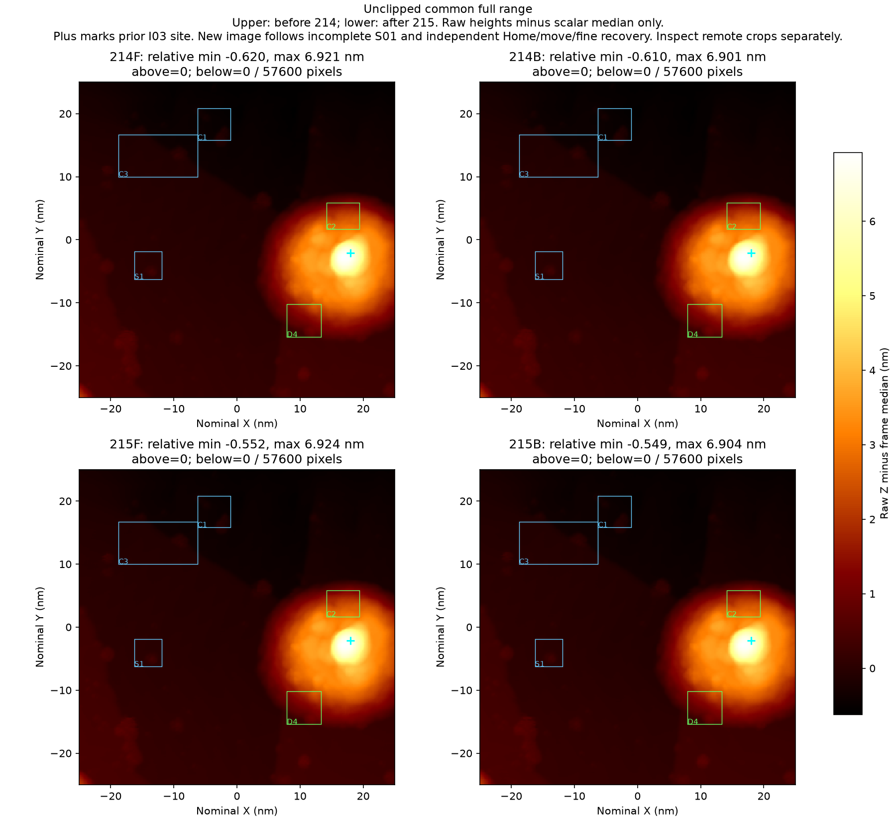
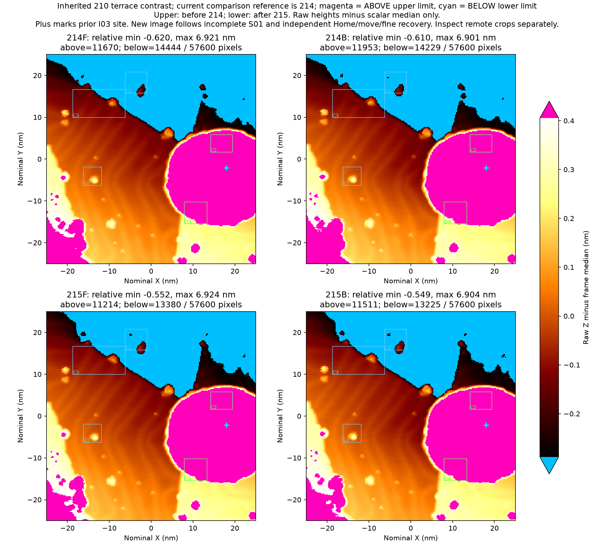
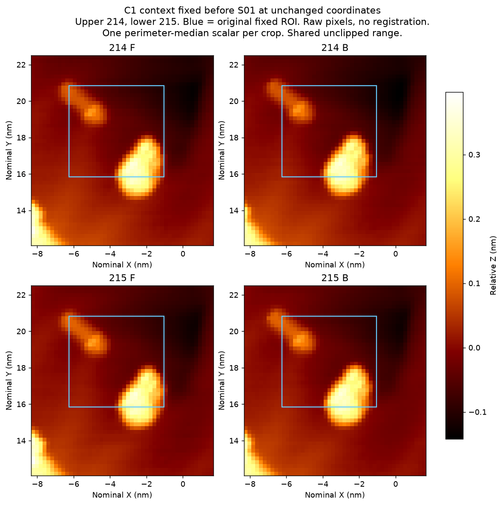
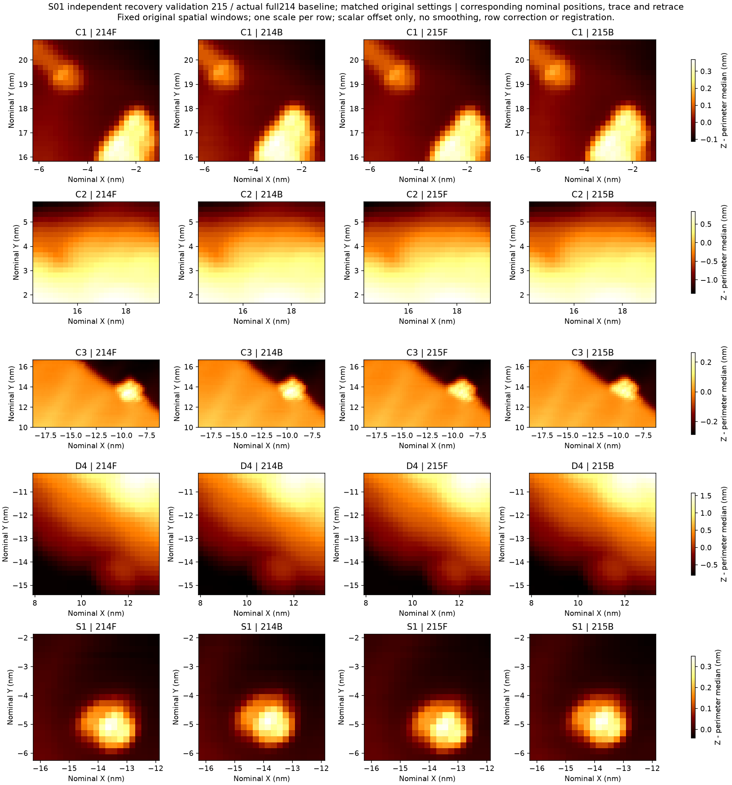
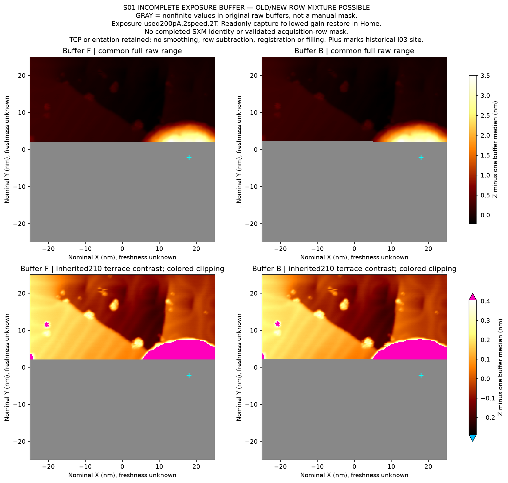
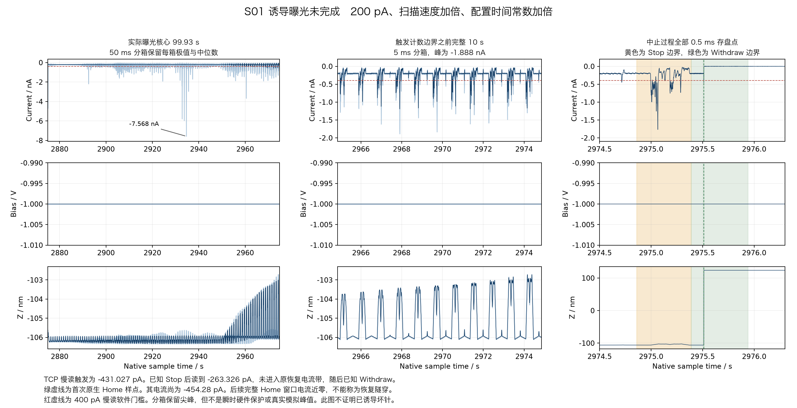

**R07 S01 扫描诱导实践记录，2026-11-03**

本次在可用的完整图214之后，尝试用较高设流、较快扫描和较慢反馈诱导针尖状态变化。一次曝光在原400 pA慢读运行门触发后中止。随后独立恢复配置、退针状态下移动回角点并重新建立隧穿，取得完整图215。215仍支持既定纳米成像任务可用，尚未建立经验证的坏态，也不能把当前可用归为一次修针成功。

截至本包历史截点，完整修针尝试累计 **2/5**，还剩3次，严格“已证实弄坏—修复—可用”循环仍为 **0**。累计脉冲 **5/6** 保持，S01没有新增脉冲或Tip Shaper。S01消耗1次扫描诱导尝试，完整诱导帧为0。此前实际修复A05的207→208及独立209验证另见 [A05报告](../au111_A05_20261103/README.md)。旧I03接触诱导形成的约7 nm局部丘体见 [I03报告](../au111_I03_20261103/README.md)，本轮未将它重新记作针尖整体坏态。

样品为Au(111)，针尖基材未确认，本轮没有取得新鲜温度读数。SXM中的旧温度注释不作为当前温度。实际操作由已核验的Nanonis TCP适配器执行，RustDesk用于界面核对。SafeTip保持Off。所有记录均保留实际参数、命令ACK、原始失败与独立恢复事件。

| 顺序 | 实际操作和观察 | 判断与后续依据 |
|---|---|---|
| R07起点 | 原参数100 pA扫描在慢读−498.708 pA时中止，已知Stop/Withdraw，回到Off/Home。保存六个部分缓冲平面 | 保留部分采集，不能当完整基线 |
| 原位置fine01 | 单次精调On后，末期电流约−293 pA、Z持续回缩，未通过原末5 s稳定门。已知Withdraw回Home | 不能因程序启动了反馈就判恢复成功 |
| 回角点fine02 | Off/Home下独立XY返回(-25,-25) nm，再精调On。原30 s观察通过。末10 s原生Z斜率约+31.01 pm/s，随后下降 | 电流在带内不代表Z静止。记录等待和漂移后取得新完整基线 |
| 完整214 | 14:17:00 CST结束。50×50 nm、240×240、−1 V/100 pA、0.912 s/方向、原增益，六平面345600个值原生/TCP逐位一致 | C1、C3、S1及分散对象支持既定纳米任务可用 |
| S01四步设流 | 100→125→156.25→195.3125→200 pA。四次已知ACK与精确读回，每步5 s检查，末30 s观察通过 | 原增益、速度下逐步建立200 pA工作点，避免把准备动作藏在曝光中 |
| S01增益、速度 | P保持3.412352×10⁻¹²，T由42.9564 μs变85.9127 μs，I项减半。速度54.8246→109.6491 nm/s，0.912→0.456 s/方向。两项各一次写入、精确回读及5 s检查 | 用户给出方向，主控选择本次倍数。三参数共同改变，不能分离各自效果。配置5 s检查不含独立Z漂移/RMS验收，另做原生审查 |
| S01部分曝光 | Start ACK 14:33:29.847196，慢读−431.027 pA触发原400 pA门。Stop ACK 14:35:10.370816。Stop后−263.326 pA未进入−240..−160 pA恢复带，继而Withdraw ACK 14:35:10.621093并确认Off/Home | Start ACK到Stop ACK为100.523620 s。原生明确界内核心为99.93 s，二者定义不同。实际结果保持incomplete |
| 独立Home恢复 | Off/Home下分三个事件恢复原Gain、原Speed、100 pA，分别14:37:07、14:39:45、14:41:19完成。每项已知ACK、精确读回及5 s检查 | 这段接近零电流、Z在Home，只支持撤回状态，不能称稳定隧穿 |
| Home移动和fine03 | 独立移动39.2839 nm回原角点，再单次On。14:47:38完成30.1569 s原精调观察。慢读末26.0027 s满足原电流带 | 此处26 s是慢读观察，不是所有2 kHz点连续满足。末10 s原生Z斜率约+30.31 pm/s，延长观察后降到+3.075 pm/s，未消失 |
| 完整215 | 14:59:01.998136已知WaitEnd，438.8028 s主机跨度，六平面和5.234 s后观察完成，无Stop/Withdraw。原参数与214匹配，345600个值原生/TCP逐位一致 | 当前限定任务可用。部分曝光、退针、配置恢复、移动、重新进针共同构成因果历史 |

完整214与215的比较保留原始高度范围。右侧旧I03丘体仍主导全图高度范围，不能用该局部丘体或大幅Z变化独自判断整根针尖失效。图内214是诱导前的新基线，215是复合恢复历史后的完整图，并非已证实坏针与成功修好针的配对。

冻结的台阶显示范围显式标出截断。它用于查看较低地形中的对象，完整原始数值仍保留。

C1主体与上方小点在正反扫中继续分离，C3台阶连续，S1仍是独立紧凑突起。C2、D4处于旧丘体影响区，不能充当独立远端正常背景。C1原固定框有裁切，完整形状依据S01前已经冻结的扩大上下文判断，原框与指标没有删除。主图未配准、平滑或逐行校正。C1/C3/S1联合位移敏感性检查的最佳位移为0行0列，相关约0.9921，仅作辅助描述，不是自动通过门槛。

两次中止各保存六个部分缓冲平面及读取完整性证据，事件身份与后来实际完整214、215分别记录。S01部分缓冲在Home增益恢复之后、速度恢复之前被只读取得，读取时配置与像素实际采集条件分别保留。有效采集行身份未独立校准，全尺寸缓冲仅作为部分曝光证据。

原生2 kHz审计把慢读触发、电流快峰和恢复分开。S01明确扫描核心中采样最小值约−7.568 nA，≥400 pA共4593点、832组，最长28 ms。严格停扫前10 s的极值为−1.888 nA，不是−7.568 nA。该10 s内≥400 pA共1901点、186组。没有命中历史负量程边缘。Stop与Withdraw的异步计数边界保留，不能把同一外包窗内的每个原生点硬归入某一条命令前后。首个Z已到Home的原生点仍约−454 pA，随后完整Home段恢复为约pA量级。

214原参数核心438.03 s内≥400 pA占0.04863%，S01核心99.93 s内占2.29811%。400 pA分别相当于4倍和2倍设流，而且扫描速度、反馈、覆盖和时间不同。因此此对比只描述曝光期间响应增强，不证明诱导已造成持续坏针。

215明确原生核心438.06 s内最小采样电流−1.749 nA，≥400 pA为416点、110组、最长14 ms，≥1 nA为19点、13组、最长1.5 ms。没有≥4 nA、>5 nA或历史负量程边缘点。最大峰约在名义row192、Y≈−15.10 nm，最长400 pA事件约在row129、Y≈−1.98 nm。没有高率XY或硬件行触发，至少保留一行不确定性，不能直接指定某个物体。

215结束到本包最后封存块的305.22 s内，没有≥400 pA或Bias变化。末30 s电流−99.825±2.861 pA、Z去趋势RMS1.900 pm、斜率+0.406 pm/s。末10 s电流−99.778±2.551 pA，Z去趋势RMS1.802 pm、斜率+0.405 pm/s。缓慢漂移仍存在。化学洁净、原子分辨和这张215后的无额外动作独立完整复扫尚无证据。

用户在S01中止后说明“1nA-5nA都可以的，因为可能有台阶”。主控前瞻地把215的两处已知扫描运行检查改为非有限电流或绝对值>5 nA时停止，等于5 nA允许。原入场、结束后取帧400 pA门、静息恢复−120..−80 pA带、精调和其他动作门保持。未给出的过载容许时长仍未知。这是慢轮询软件门，不是硬件损伤阈值，也不限制所有更快原生点。原400 pA失败记录未改写。

本次实践继续分别记录图像功能、局部地形响应、异步电学和恢复状态。T加倍描述设定变化，实测闭环响应仍需校准。Home阶段确认撤回状态，隧穿恢复由独立On及观察证据确认。后图支持当前任务可用，诱导是否曾造成持久坏态与化学状态仍待证据。已知中止后的独立恢复与正常完整曝光后的返回流程分别绑定实际历史，未知写入状态要求停止自动后续。Skill候选另行维护，已冻结规程保留。

本包发布完整214、215原生SXM、对应六平面，以及两次部分缓冲的各六平面。R07在历史截点仍在记录，不存在本包所称的终态关闭。已封存1–377块共9425000行/通道、4712.5 s、六通道，完整索引和SHA保留。上传选定79个DAT压缩块，共1975000行/通道、987.5 s，其余原生DAT留在本机。所有上传缺口在[覆盖表](coverage.json)列明，不等于采集缺口。选取保留触发、恢复、配置与精调窗口、部分曝光、全图端点和峰块，以及最新封存末窗，完整扫描原生时间序列未全部上传。

图像查看顺序与I03丘体关系见[图像索引](IMAGE_INDEX.md)。可核对[完整215电学审计](evidence/native_audits/S01_restored215_native_review.json)、[最终封存后窗](evidence/native_audits/S01_restored215_post_through377_native_review.json)、[图像正式判读](evidence/image_review/recovered215/post_manual_review.json)和[来源索引](source_index.json)。原始JSON和源代码保留本机路径以支持历史溯源，README采用包内相对链接。执行源仍依赖原本机冻结组件，发布用途为审计，不是独立硬件控制入口。

运行 `PYTHONDONTWRITEBYTECODE=1 python3 verify_package.py` 可离线核验所有载荷、嵌套manifest、压缩原始字节与包内对应的来源摘要。后续S02不在此历史包中，不回写S01结论或释放已消耗次数。
