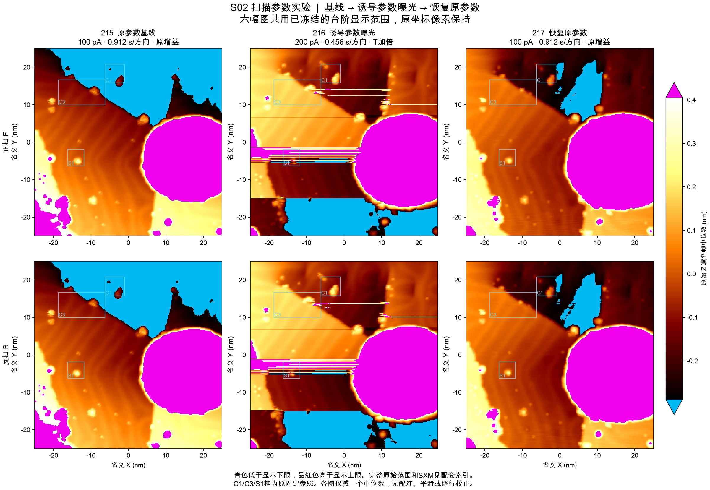
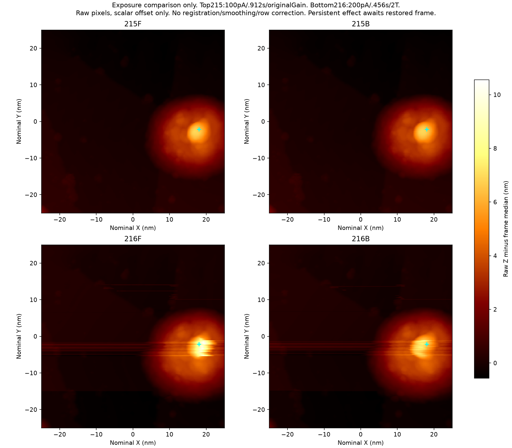
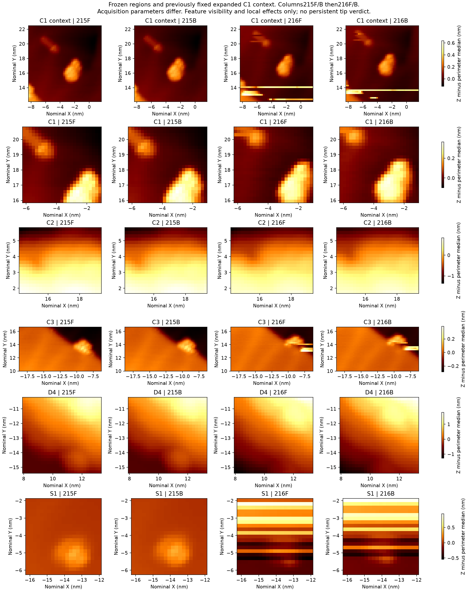
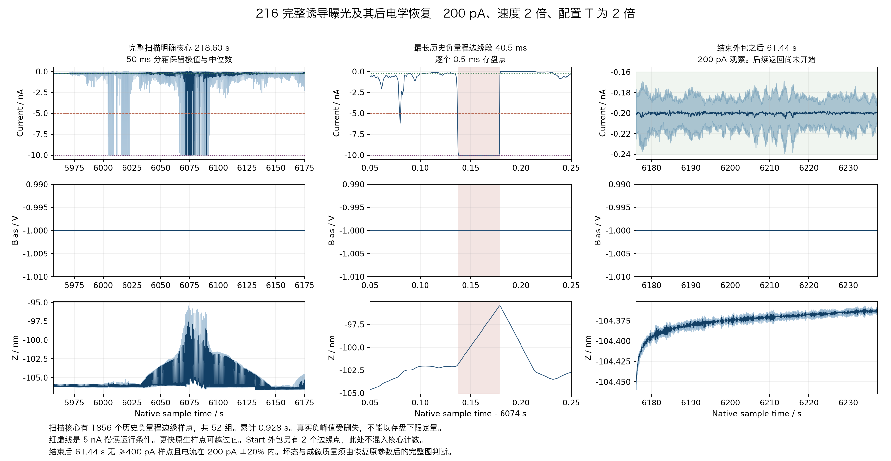
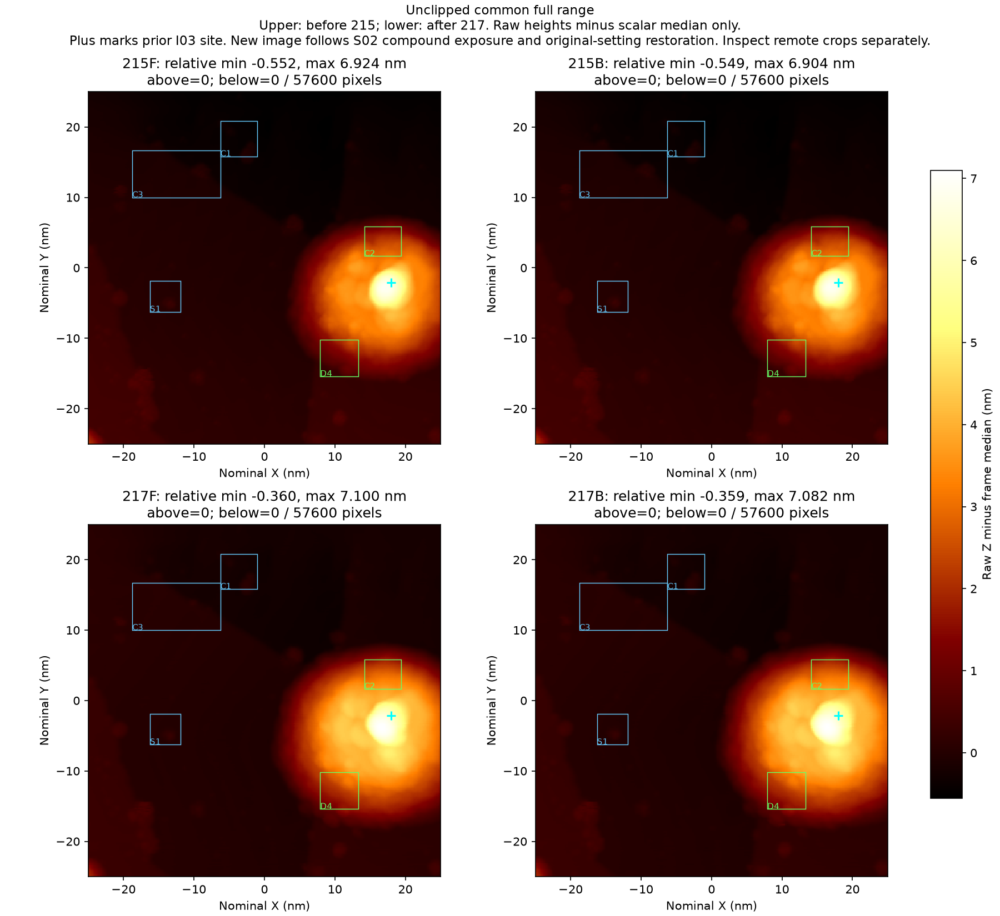
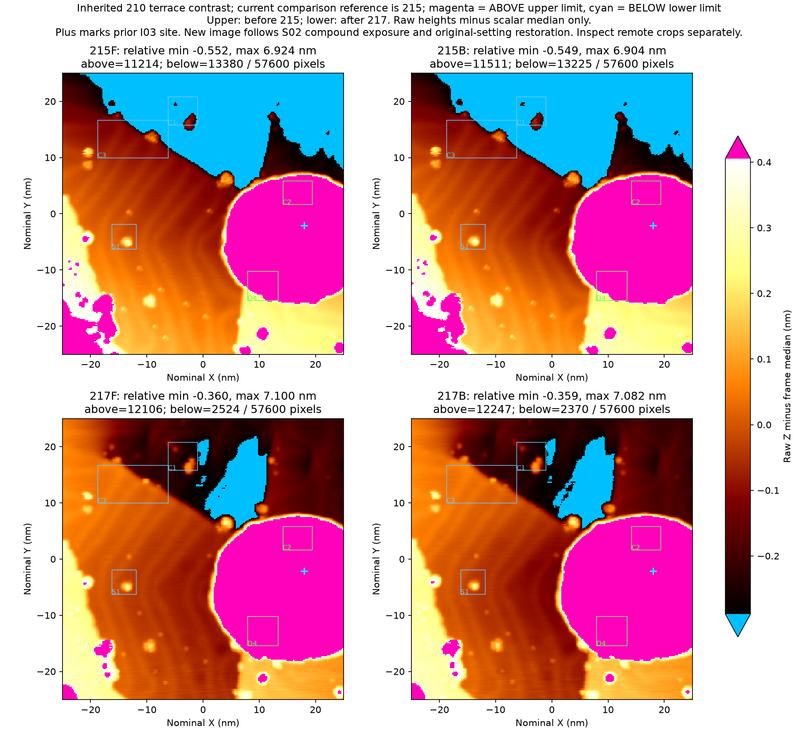
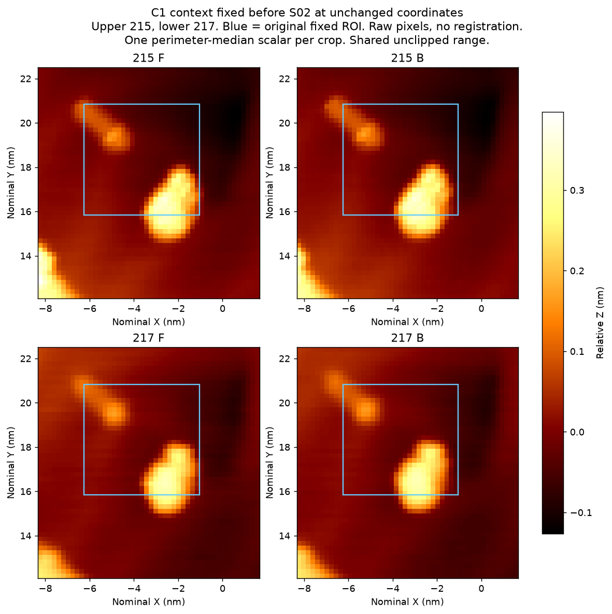
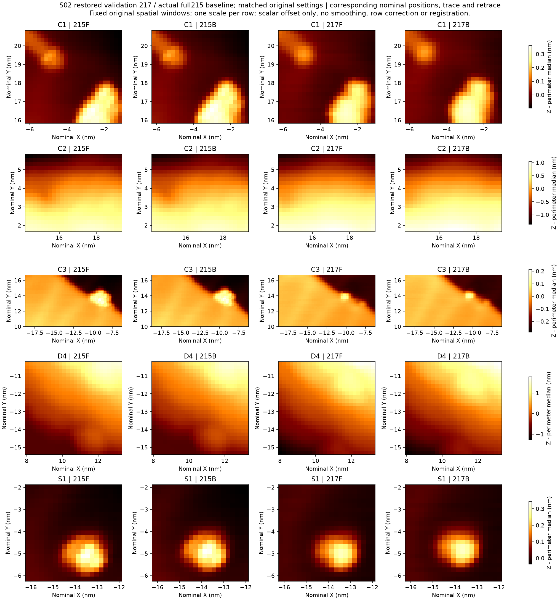

# R07 S02 完整扫描诱导与原参数验证，2026-11-03

本次完成一张200 pA、2倍扫描速度、2倍积分时间常数的完整曝光216。随后按已冻结的四步序列返回100 pA，恢复原增益与原扫描速度，取得完整验证图217。217仍支持既定纳米成像任务可用。216中的强横条纹消退，C3近台阶突起明显变弱。这些变化分别保留。持续任务坏态尚未建立，本次新增修针尝试与严格循环均为0。

三列依次为原参数215、改变参数曝光216、恢复原参数217，上排正扫、下排反扫。冻结台阶显示范围的超界像素以青色和品红色标出，原始完整高度值保留。

本次继续用户提出的“扫描快一些、反馈慢一些、设流大一些”方向。主控选定一次有限完整曝光，保持S01同一物理配方。区别是扫描运行采用已明确的5 nA慢读门，避免重复用已被用户更新的400 pA运行门。实际调理历史保持原有脉冲与Tip Shaper次数。

历史完整修针尝试累计 **2/5**，仍余3次。严格“经证实弄坏—修复—可用”循环 **0**。共享脉冲 **5/6** 保留。S01部分曝光算一次诱导尝试，S02是第二次实际扫描诱导尝试、第一张完整改变参数曝光帧。S02本身没有修针动作，不增加完成修针次数。旧S01的中止、Home恢复、再进针和完整215另见[S01报告](../au111_R07_S01_20261103/README.md)，不改写原失败或重置次数。

样品为Au(111)，针尖基材未确认。本轮没有新鲜温度读数。SafeTip保持Off。原始图像、实际参数、命令ACK、回读、原生电学及各动作间等待均分别记录。

| 顺序 | 真实操作与证据 | 判断依据 |
|---|---|---|
| 曝光前215 | 完整50×50 nm、240×240像素、−1 V/100 pA、0.912 s/方向、原增益。C1/C3/S1支持既定纳米任务可用。六平面345600值原生/TCP逐位一致 | 从已有完整可用图出发，右侧旧I03约7 nm丘体仍是局部历史，不重标为全针尖坏态 |
| 四步准备 | 100→125→156.25→195.3125→200 pA。4个已知ACK、精确读回、每步5 s与末30 s完成 | 准备阶段与正式扫描曝光分别保留 |
| 减慢反馈、加快扫描 | P保持3.412352×10⁻¹²，T从42.9564 μs变85.9127 μs，I项减半。速度54.8246→109.6491 nm/s，0.912→0.456 s/方向 | T的设定变化不等同于已校准的实际闭环带宽。三参数共同变化，不能分离单项原因 |
| 首次本地尝试拒绝 | 输入使用相对logger目录，与READY中的绝对目录不相等，07:15:42 UTC在TCP连接及Start之前拒绝。原目录无events、无Start claim、wire为空，所有发送/ACK/owned/unknown标志false | 原reservation与失败完整保留。没有物理曝光，不将它算作一次Start。修正入口后另立full02，不重用旧claim |
| 实际完整216 | full02 Start claim 15:24:51.548438 CST，已知成功响应于15:24:51.560924完成。原生明确界内曝光核心218.60 s，完整六平面345600值原生/TCP逐位一致 | 第一次完整扫描诱导曝光。它在200 pA、2倍速度、2倍T条件下取得，不能直接作为原参数下持久坏针证据 |
| 原生曝光响应 | 核心1856个历史负边缘点、52组、累计0.928 s，最长40.5 ms。>5 nA共2135点、114组，最长42 ms。Start边界另2个负边缘点不并入核心 | 实际峰值在量程边缘被截断。5 nA慢读门只检查当次软件读值。更快原生点独立保留，物理损伤阈值与容许过载时长仍未知 |
| 曝光后恢复 | 紧接完整216后61.44 s原生电流全部在200 pA±20%内 | 电学恢复是后续返回依据，不是图像质量结论 |
| 正常四步返回 | **200→195.3125→156.25→125→100 pA**，4个已知ACK，原观察完成 | 早先root理由误写160/128/102.4。实际冻结代码与wire采用准备序列反向值，独立勘误保留原理由，没有追加命令 |
| 原参数恢复 | 原Gain与原Speed分别单次写入、严格ACK、精确回读与观察完成 | 正常返回恢复没有S01那次Withdraw/Home/重新On的额外作用历史 |
| 原参数217 | 15:45:12.463931 CST已知WaitEnd，到WaitEnd的主机扫描计时为438.773 s。完成六平面存档与5.079 s后观察，345600值逐位一致 | C1主体与上方小点保持分离，C3主台阶连续，S1紧凑可辨。任务可用，局部C3变化单独记录 |

曝光216的低地形条带更明显，旧丘体仍在。1856个核心边缘点中1765点位于名义rows120–147，另外91点位于rows52–72，和图像条带区相容。行对应至少保留1行误差，没有高率XY或扫描方向硬同步，不能指定每个点落在哪个原子或对象上。这说明曝光有电学和控制响应，不证明表面发生某种确定材料转移。

恢复原参数后的完整217与215采用相同场、像素、偏压、设流、增益及线时间。主图仅作单个标量高度平移，未配准、平滑或逐行校正。全高度范围保留右侧旧丘体，冻结台阶显示范围明确标出截断。

C1的主体与原上方小点在正反扫都保持背景分隔。原固定小框裁到主体下缘，因此同时显示在S01之前已固定的扩大上下文。C1局部轮廓改变，但对象分离任务仍满足。S1在正反扫重新呈清楚的紧凑突起。216中穿过该窗口的强条纹已消退。

C3主台阶保持连续，近边突起明显变弱。其固定mask残差中位数由215的正反扫约241 pm变为217的71/67 pm。这个量描述固定像素集合，物体形状、样品响应、针尖卷积与漂移贡献尚未分离。C2和D4继续处于旧丘体影响区，独立远端参照采用C1、C3和S1。当前主参照未共同出现影响任务的持续复制或广泛拖尾。

联合C1/C3/S1的位移敏感性检查得到最佳−1行、0列，名义Y约+0.208 nm，相关0.9426。原坐标相关0.9313。它仅辅助描述位移敏感性，判断没有采用相关阈值。图像支持当前限定任务可用。化学洁净、原子分辨及精确材料变化仍未知。217之后无额外操作的独立完整复扫尚未取得。

217明确原生扫描核心437.86 s内，采样最负电流−2.724093 nA，名义row200、Y约−16.77 nm。≥400 pA为324点、84组，最长8.5 ms。≥1 nA为53点、24组，最长2.5 ms。没有>5 nA或历史负量程边缘点。结束后35.0 s的末10 s电流−100.570±6.487 pA，Z去趋势RMS2.893 pm，斜率+0.370 pm/s。缓慢漂移仍存在。行位置至少有一行不确定性，缺少高率XY与扫描方向硬同步。

这组结果支持采集参数和动态响应影响216条纹的解释。三参数准备、完整曝光、分步返回和配置恢复共同构成实际历史，各项独立贡献尚未分离。局部C3对比变化也保留了持续材料或针态变化的可能，当前图像没有建立影响既定任务的坏态。

另有两项纯离线问题。首次恢复增益原生审计只封存至521块，覆盖不足，后来补至527块后完成核验。图像比较v2对216的六个相对矩阵路径拒绝，v3逐一绑定实际矩阵并核SHA后完成。原拒绝记录和修复说明均保留。这两项分析修复没有新增硬件操作，也没有改变科学ROI或图像算法。

本包保留完整215/216/217原生SXM及对应六平面，便于离线复核。R07本地封存1–577块，共14425000行/通道、7212.5 s、六通道。选取上传69块，共1725000行/通道、862.5 s。它们包含完整216曝光与立即恢复477–499块，以及准备、返回、配置和217核查窗口。217的11个选取块覆盖开头、关键峰组和末35 s恢复，完整217的原生序列留在本机。完整封存索引、选取范围和SHA见[覆盖表](coverage.json)。R07在本包截点仍在记录，终态关闭未纳入此包。

主控独立查看完整图与对象图后，接受当前任务可用、诱导坏态未建立的判读。当前处于下一组定量诱导方法与削顶处置标准的实验员复核阶段，主包截点没有新增动作选择。参见[主控图像核对](evidence/image_review/root_image_acceptance.json)。

图像入口见[图像索引](IMAGE_INDEX.md)。原始JSON和源代码保留本机路径作为历史来源，报告只用相对链接。已执行控制源保持冻结，它们用于版本审计，不能作为脱离本机证据和独立选择的运行入口。benchmark结果与Skill分开维护，本包不自动更改Skill。

可运行 `PYTHONDONTWRITEBYTECODE=1 python3 verify_package.py` 核验所有载荷、嵌套manifest、压缩字节、原始来源摘要、无发送拒绝和实际返回勘误。
