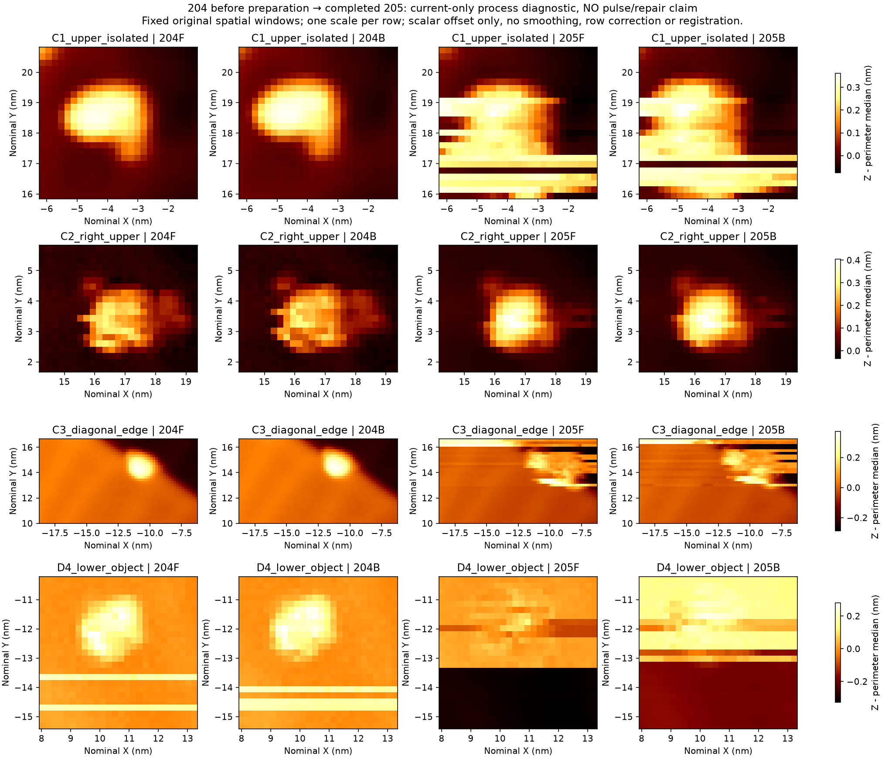

# Au(111) 续实验精选证据（本机 2026-11-03；UTC 2026-11-02）

这是上一[前置证据包](../au111_five_sessions_20261102/README.md)之后的离线增量。**仍为 1/5 次完整尝试、0 次严格成功闭环、余 4 次；累计已执行脉冲 3 次。** 恢复隧穿、诊断扫描、准备电流改变和前检拒绝均不补算修复成功。

**最终记录状态：R03已于本机02:46:45停止，完整761块归档核验完成，见[终态补注](TERMINAL_ADDENDUM.md)。** 以下初始732块截面保留为历史，不是当前运行状态。

初始截止：205 完整图已审；A03 于 UTC 18:39:07.437975（本机 02:39:07）在前检拒绝，未发送 TipShaper 配置/Start、Pulse 或撤针。root 等待实验员回应。R03 采集清单冻结 1–732 闭合块；记录器当时仍在运行，**不是终态归档**。最新选入的 205 后静息波形审查到第710块、约527秒；不能把732块均称已做科学波形审查。状态可能在本包截止后改变。

## 实际过程

| 阶段 | 事实与限制 | 证据 |
|---|---|---|
| 手动历史、R02/R03恢复 | 用户补充先 Withdraw 再 +Z 五六下；次数不能换算距离。两次 fine On、三次有限 AA 搜索；最后 fine02 重建隧穿，不是修好针。 | [恢复报告](evidence/continuation_slow_20261102/recovery_R02_R03_through_fine02_20261103/REPORT.md) |
| 201–202 | 两张完整匹配图支持限定纳米对象/边缘辨识；C1/C3冻结为主要独立参照，C2为定位区域。保留局部纹线，不要求化学洁净。 | [201/202判读](evidence/continuation_slow_20261102/compare201_202_offline/manual_functional_review.json) |
| 定位后203 | 移动与停止、静置、I01前检拒绝；没有TipShaper.Start。多个参照可辨性下降，晚期静息也出现工作点变更。 | [202–204诊断报告](evidence/continuation_slow_20261102/diagnostic202_203_204_report/REPORT.md) |
| 无调理204 | 同条件完整复扫中对象/边界重新清楚，仍有局部条纹；不能称修复成功。 | 同上 |
| P01准备/独立恢复 | 六级升至381.47pA时Z门槛拒绝；随后另一个已审流程六级降回100pA。没有Pulse；原生噪声在降流前已部分下降，不能唯一归因降流。 | [准备与恢复报告](evidence/continuation_slow_20261102/P01_preparation_recovery_addendum/REPORT.md) |
| 205 | C1/C3参照质量下降、D4受宽带干扰；C2仍清楚。204→205含准备、等待、降流与扫描，不是脉冲/修针前后。 | [205报告](evidence/continuation_slow_20261102/REPORT205_current_only.md) |
| A03未执行 | 195慢样、所有电流在原带内；末约10秒Z RMS13.733pm超过冻结10pm。3425请求头独立核验全为getter。旧门槛未放宽、旧拒绝未重标通过。 | [无动作报告](evidence/continuation_slow_20261102/A03_no_action_review.md) |

本批 R02/R03 **新Pulse0、TipShaper.Start0、成功诱导0**。图像功能为主判，原生I/Z用于恢复和因果核对；局部物体变化或尖峰不自动等同全针坏。历史化学/原子身份和绝对间隙未确认。203→204无调理恢复说明后来改善仍需保留自发/时间变化解释。

## 完整图与原始文件

五张完整SXM及分析矩阵均在本包。每帧50×50nm、240²、DOWN、−1V/100pA、0.912s/方向；每份本地quality报告保留六个平面345600个float32与TCP/原始回包逐位匹配结论。完整TCP回包不上传，故离线包验证只重新核验导出文件，不能重新运行未上传TCP的逐位比较。

- **201**：[SXM](evidence/session_02/baseline_segment03_full/native/BM261029_00201.sxm) · [完整原始/全局平面 F/B](evidence/session_02/baseline_segment03_full/analysis/Z_raw_globalplane_FB.png) · [电流 F/B](evidence/session_02/baseline_segment03_full/analysis/Current_raw_FB.png) · [质量及完整性](evidence/session_02/baseline_segment03_full/analysis/quality_report.json)
- **202**：[SXM](evidence/session_02/baseline_segment03_confirm_full/native/BM261029_00202.sxm) · [完整原始/全局平面 F/B](evidence/session_02/baseline_segment03_confirm_full/analysis/Z_raw_globalplane_FB.png) · [电流 F/B](evidence/session_02/baseline_segment03_confirm_full/analysis/Current_raw_FB.png) · [质量及完整性](evidence/session_02/baseline_segment03_confirm_full/analysis/quality_report.json)
- **203**：[SXM](evidence/session_02/after_localization_I01_full/native/BM261029_00203.sxm) · [完整原始/全局平面 F/B](evidence/session_02/after_localization_I01_full/analysis/Z_raw_globalplane_FB.png) · [电流 F/B](evidence/session_02/after_localization_I01_full/analysis/Current_raw_FB.png) · [质量及完整性](evidence/session_02/after_localization_I01_full/analysis/quality_report.json)
- **204**：[SXM](evidence/session_02/pre_repair_A02_observed_full/native/BM261029_00204.sxm) · [完整原始/全局平面 F/B](evidence/session_02/pre_repair_A02_observed_full/analysis/Z_raw_globalplane_FB.png) · [电流 F/B](evidence/session_02/pre_repair_A02_observed_full/analysis/Current_raw_FB.png) · [质量及完整性](evidence/session_02/pre_repair_A02_observed_full/analysis/quality_report.json)
- **205**：[SXM](evidence/session_02/after_preparation_recovery_P01_full/native/BM261029_00205.sxm) · [完整原始/全局平面 F/B](evidence/session_02/after_preparation_recovery_P01_full/analysis/Z_raw_globalplane_FB.png) · [电流 F/B](evidence/session_02/after_preparation_recovery_P01_full/analysis/Current_raw_FB.png) · [质量及完整性](evidence/session_02/after_preparation_recovery_P01_full/analysis/quality_report.json)

## 可移植性、来源与验证

- [动作/ACK精简账本](actual_actions.json)保留实际命令和结果的原SHA；缺ACK时刻的旧文件保持缺失，不补造时间。
- [源SHA索引](source_hash_index.json)区分原文件与导出文件哈希；[转换清单](transformation_index.json)记录JSON路径与报告链接变换。PNG/SXM/NPZ不改像素或数组。历史报告附带导出说明，结论不回写。
- JSON内被转换的已选中绝对路径改为相对其所在文件；原有相对字符串仍按原证据上下文解释，不承诺每个未导出的内部文件可打开。`local-archive:`项目在[省略清单](omitted-evidence.md)中定位。内嵌原始SHA仍对应原文件，不冒充导出SHA。
- [DataLog逐文件清单](raw_archives_not_uploaded.json)列出R02 93块、R03 732块的原SHA/大小/行数。根控制者冻结的双哈希回执为哈希依据；打包另核本地大小，不宣称再次分析全部原生。GB级矩阵留本地。
- [Skill Step04导出记录](skill_step04_export.json)：只追加已安装本机规程Step04并改证据链接；Skill主文件、profile、scripts及既有政策均不改。A03门槛科学草案仅为未激活研究，不是新许可。

运行 `python verify_package.py` 可离线检查本包字节和相对链接。发布不包含凭据、厂商程序/手册、运行环境、实机控制脚本或全TCP dump；不并入synthetic/Demo分数。
