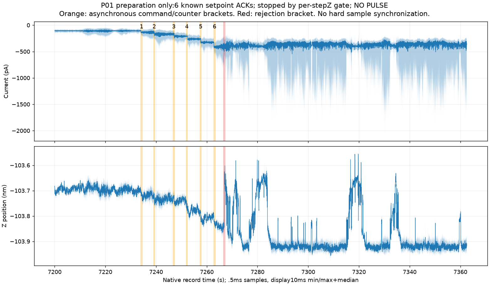
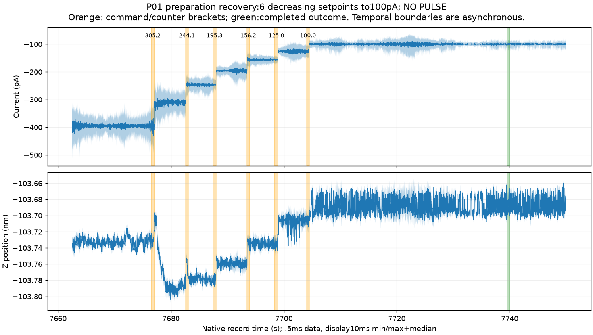

> Portable export of a dated source. Original SHA-256: `c9b43e438c1ef7906f5f58a6780a3e954fe079e002d5a5b1fdf2db99952481ba`. Local links were remapped; historical conclusions were not updated. See the package README for the final cutoff.

P01：电流准备中断与降回100pA（下一幅完整诊断图之前）

本次实际完成了六级升流和六级降流，**没有发出P01脉冲，也没有TipShaper.Start**。升流准备在381.47pA阶段因单步Z变化门槛中断；随后通过独立审阅的恢复流程降到100pA。该记录不能称为“打脉冲修后”、成功诱导或完成修针闭环。成像功能变化仍待下一幅完整、同条件图归档后判读。

| 已执行阶段 | 本机时间（2026-11-03） | 实际结果 |
|---|---|---|
| 准备升流 | 02:08:47–02:09:20 | 100→125→156.25→195.31→244.14→305.18→381.47pA，六次写入均已知ACK；未达到1nA。 |
| 停止继续设置后 | 原生审至7362.5s | 目标仍381.47pA，反馈仍On2；没有自动退针、回滚或脉冲。 |
| 独立降流恢复 | 02:16:10–02:17:12 | 六级反向设定305.18→244.14→195.31→156.25→125→100pA，均已知ACK，完成最终观察。 |

这里“停止”表示脚本停止继续设置电流，**不是关闭反馈**。原始结果见[准备outcome](../../session_02/prepare_induction_P01/outcome.json)、[恢复outcome](../../session_02/recover_prepare_induction_P01_01/outcome.json)。

上图上轴为原生电流pA，下轴为Z位置nm，横轴为原生记录时间s；浅色带保留每10ms内的最小/最大值，深线为中位值，统计使用全部0.5ms样点。橙色为命令与原生计数器的异步时间括区，红色为脚本中断括区，不是精确硬同步。

前五级主要表现为升流后的Z接近；第六级早期也从约−103.800nm降至−103.840nm。随后约7266.888s出现−1.851nA样点并伴随Z向上响应，之后目标保持381.47pA仍有约0.1–0.3nm往返。中断后95.33s内最负−2.094nA，5238个样点达到1nA量级，未匹配已知软件下限；末10s电流−445.77±208.90pA，Z去趋势RMS28.80pm。不能把平均电流接近目标当作已恢复，也不能把这些波形直接标为化学污染或坏针图像。

“+175pm”是被慢采样捕捉到的真实动态之一，但不是一个随后保持不变的正台阶：原生记录显示多次向上偏移后返回约−103.92nm。其原因尚不能在结构型变化、反馈/电子响应与松弛之间唯一识别。此阶段没有观察到软件量程点；这也不等于已校准证明模拟链完全线性。完整证据见[准备原生审查](../P01_prepare_native_review/review_through589.json)和[解释](../P01_prepare_native_review/interpretation_through589.json)。

恢复图仍按同样方式显示原生I/Z；绿色括区是已知完成结果。首次降至305.18pA还出现额外负向Z变化，后续各级降低电流时Z总体升高，因此并非完美可逆的单一I(z)曲线。

**重要因果限制：降流开始前已先变安静。** 在381.47pA的恢复前10秒，原生电流为−396.06±21.87pA，Z去趋势RMS5.86pm，已不同于较早的强烈往返阶段。故后来的改善不能全部归因于降流。降回100pA后，大幅往返未在已审末窗重现：

| 原生窗口 | 电流均值±标准差 | Z斜率 | Z去趋势RMS |
|---|---:|---:|---:|
| 恢复结果前30s | −100.58±11.02pA | −0.0495pm/s | 11.14pm |
| 归档末10s | −100.21±6.09pA | +0.0524pm/s | 10.69pm |

上述100pA窗口没有≥400pA样点，也没有≥0.1nm的相邻1秒中位跳变。仍保留约11pm的Z残差；原生2kHz结果与慢采样末10秒9.8995pm的窗口、带宽不同，不能混称均满足同一个10pm条件。此处没有事后新增原生门槛，也没有改变既有门槛。恢复结果之后仅另覆盖9.98秒，不代表永久稳定。见[恢复原生审查](../P01_recovery_native_review/review.json)、[解释](../P01_recovery_native_review/interpretation.json)。

最新已经判读的完整图仍是[204限定功能参考](../compare202_204_offline/manual_review.json)。下一幅图将与204做电流设定流程前后比较，并保留202定义的C1/C3固定参照；C2仍是定位区，D4用于辅助诊断。位置、形状变化不自动等于功能下降；需要看对象辨识、边界、局部与跨区域线条以及F/B，而非仅看电流均值。

本附录截至恢复完成与对应闭合原生块，不包括下一幅图的任何结果。五次任务计数不增：沿用完整尝试1/5、剩余4、成功闭环0；P01脉冲执行数为0。较早准备异常完整保留，未因恢复而删除或改写。所有链接和完整SHA256见[source_index.json](source_index.json)。
