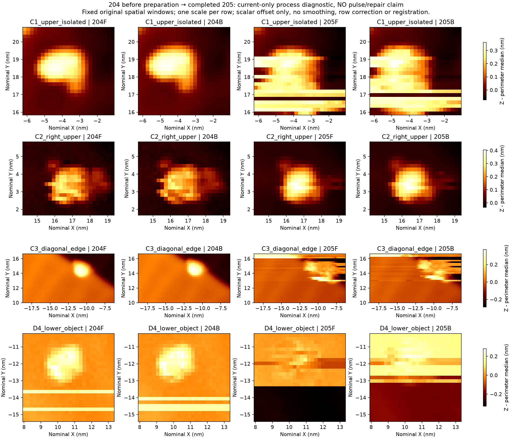
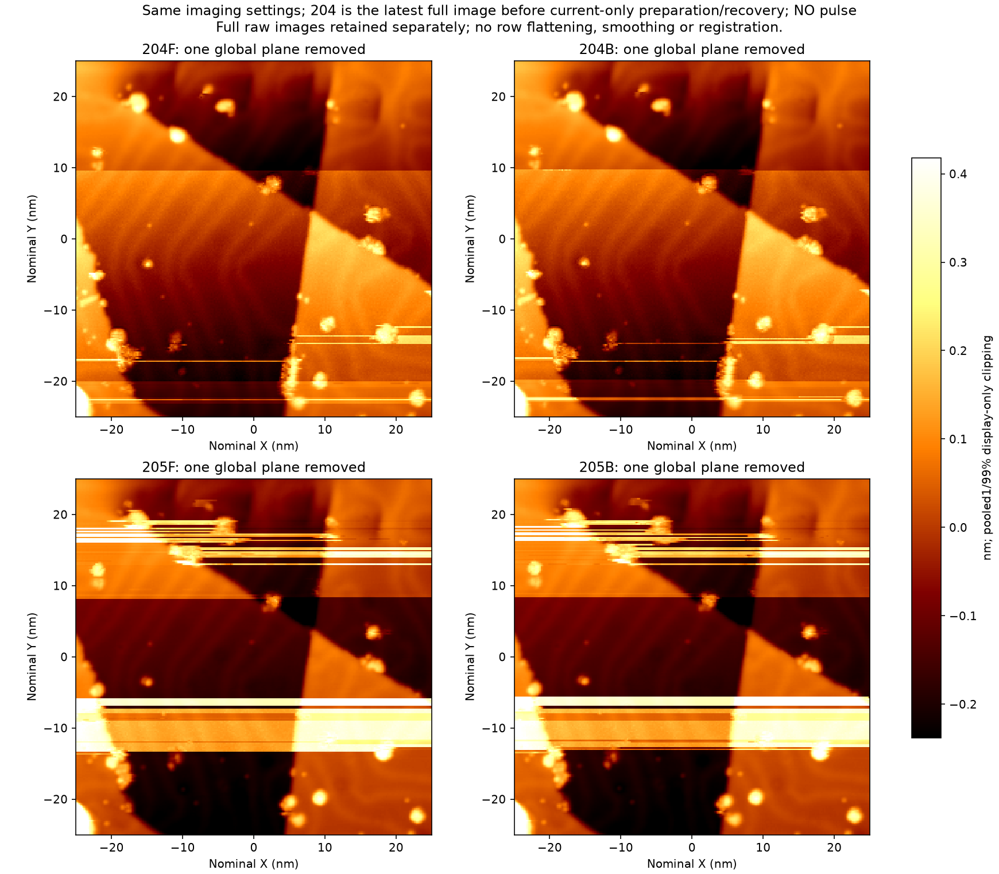

> Portable export of a dated source. Original SHA-256: `0b108f19206d47c2d839e7017bacadb84a912d7bbe06f229017bede0be53b7af`. Local links were remapped; historical conclusions were not updated. See the package README for the final cutoff.

# 204 → 205：电流准备与恢复后的完整成像诊断

205 相对 204 出现了**任务相关图像质量下降，同时保留部分区域的成像功能**。固定 C1 的下轮廓与背景受长横线干扰，C3 斜边邻近凸起在正反扫均出现横向拉线，D4 参照落入大幅背景偏置带；C2 仍清晰，C1 主体及粗斜边仍可定位。因此不能继续把 204 的可靠参照状态原样沿用到 205，也不能据此宣称全幅或所有针尖功能失效。

本记录是电流准备、等待、独立降流恢复与扫描之后的诊断，**不是修针前后图**。本段没有执行 `Bias.Pulse` 或 `TipShaper.Start`；不计成功诱导、不计新修复闭环，不增加五轮任务完成数。化学组成、原子分辨和唯一微观机制均未建立。

## 完整数据与比较方法

- 205 实际原生文件为 **BM261029_00205.sxm**。扫描 UTC 2026-11-02 18:20:01.883433–18:27:20.687505（本机次日 02:20–02:27），约 438.801 s。
- 50 × 50 nm、240 × 240、DOWN、−1 V、100 pA、每方向 0.912 s，与 204 成像设置一致。原生 SXM、六个 TCP 平面及原始回包的 **345600 个 float32 逐位匹配**，全有限值。
- 主要比较 204 → 205，同时保留原先冻结的 202 C1/C3 窗口。未移动 ROI、修改阈值、逐对象配准或逐行消除横带。
- 下图每行是空间区域 C1/C2/C3/D4；四列依次为 **204 F、204 B、205 F、205 B**。只减每框外围中位值，同一行共用色标，无平滑或配准。C2 为此前定位区，不当作远离干预点的独立控制。

全场辅助图采用明确标注的单一全局平面和显示色阶裁切；数据及测量未裁切。原始全场另存于[205 原始及全局平面图](../session_02/after_preparation_recovery_P01_full/analysis/Z_raw_globalplane_FB.png)、[205 电流图](../session_02/after_preparation_recovery_P01_full/analysis/Current_raw_FB.png)。

## 可复核的变化

| 项目 | 观察与限制 |
|---|---|
| C1 | 外围 MAD：204 F/B 14.03/12.94 pm → 205 98.03/68.70 pm。主体仍可见，但下缘与背景分离受横线影响；半高宽触框，不再解释为颗粒直径。 |
| C3 | 斜边仍可见，边缘凸起两向均出现拉线与轮廓破碎。表观位置或对比改变不等于物体消失，也未证明统一漂移。 |
| C2 | 两向仍紧凑可辨，测得局部峰高约 406/406 pm；高度或形态改变本身不判失败。 |
| D4 | 旧位置嵌入新偏置带，F/B 背景明显不同；自动极值和宽度受带边缘污染，不能当物体宽化证据。 |
| 全宽偏置 | F 的行 147→148 四个 X 四分区约 +516、+519、+520、+516 pm；行 152→153 约 −525、−522、−511、−522 pm。B 有对应大幅带。它们超出单个颗粒的局部轮廓变化。 |
| F/B 一致性 | 全图仅去常数差的 Z RMS：28.31 → 60.58 pm，为描述指标，不是事后新增通过线。 |

现有 ±4 像素搜索只检查 **C1/C3 与 F/B 共用一个位移**的敏感性，不是全图 phase correlation，也未用于图像配准。C3 局部响应或对象变化仍可能存在；不能用共同位移解释掉全宽横带。205 的 SXM 电流像素 RMS 为 F/B 6.25/11.69 pA，虽小于 204，图像功能却下降，说明电流均值或像素噪声不能替代图像判断。

## 同期原生 I/Bias/Z

原生审计固定到 R03 第 692 闭合块，覆盖扫描后 **302.14 s**，不是持续更新的实时结论。所有统计由已哈希的原生审计引用；主机时间与计数器异步，扫描边界分开处理，不做硬像素同步。

| 窗口 | 原生结果 |
|---|---|
| 扫描核心 438.02 s | 最负 I −2.6461 nA；161 点幅度 ≥400 pA、6 点 ≥1 nA；0 点 ≥4 nA、0 个精确软件下限匹配；最大相邻 Z 变化 133.43 pm。栅格内 Z 包含形貌，不能把全帧 Z 斜率当静态漂移。 |
| 扫描后 302.14 s | 仅 1 个幅度 ≥400 pA 样点：−407.123 pA，位于保守结束边界后约 25.283 s；无 ≥1 nA 或精确下限匹配。 |
| 末 30 s | signed I −111.887 ±28.393 pA；Z 线性斜率 −0.356 pm/s，去线性 RMS 15.402 pm。 |
| 末 10 s | signed I −110.757 ±22.814 pA；Z 斜率 +0.072 pm/s，去线性 RMS 14.879 pm。 |

“±”表示标准差，不是置信区间。相邻 1 s 的 Z 中位值变化 ≥100 pm 只在立即扫描后的 native 8349 s 出现一次约 +291 pm；此描述查询不是物理安全阈值。结束定位、蠕变或反馈松弛都可能参与，缺少高频 XY，不能唯一归因。后续仍有约 15 pm 的 Z 起伏，不等于结构静态。302 s 内未见后续同类大跃变，不能排除更晚变化；203 的另一次工作点变化曾出现在更长延迟之后。

## 归因边界

204 与 205 之间包含 100→381.47 pA 准备（第六步 Z 门槛拒绝后停止加流）、等待、独立降回 100 pA、再扫描。准备阶段出现的原生大噪声在降流前已经减弱，不能把噪声变小全部归于恢复过程。205 的变化目前只支持这一复合区间之后功能下降，不能指定某一步造成。

时间变化的有效结响应、局部形貌触发的反馈/扫描恢复、C3 局部对象或电子对比变化等均未排除；化学污染与原子身份未测定。此前 203→204 在没有调理的情况下功能回升，故后来任何改善仍需明确保留自发或扫描相关恢复这一替代解释。已有人工判读、判据、原图与历史计数均未改写。

## 源文件与 SHA-256

| 来源 | SHA-256 |
|---|---|
| [原始 SXM](../session_02/after_preparation_recovery_P01_full/native/BM261029_00205.sxm) | `b0056330eed4b7ce1f642d094c9cde90ab0d8c2500958783ac45b04408a66364` |
| [完成记录](../session_02/after_preparation_recovery_P01_full/outcome.json) | `b4d7c5d05b222715a50614ed25733bac2f9a603b3389e184497c1d33917fcd75` |
| [六平面校验及质量统计](../session_02/after_preparation_recovery_P01_full/analysis/quality_report.json) | `c0ffd52f93afc385bba8306e1d4e5949e1f3afdc88eb9d165057183cba833dfe` |
| [固定判据人工图像结论](compare204_205_offline/manual_image_review.json) | `6f5ecc8ccc80c9eec6f3ef4a18dbf16d4f633c1f8e98d5cafa4761d7841c886e` |
| [图像测量](compare204_205_offline/image_measurements.json) | `ba2ce797dc73c2640b3942255705235748cf577cf97db3d55daff1b92e6a0869` |
| [固定 202 对照](compare202_205_offline/image_measurements.json) | `9e3d6509ade2b9c8427399bab200f0486b3d8c887520a35daa51f46b27ac6bfc` |
| [扫描与后续 302 秒原生审计](native205_post302s_review/review.json) | `b766605fe104ddcdf828dfdac6175a0b4f6d48af5b9f7ad69a7a02154eac00fb` |
| [独立原生与机制补注](compare204_205_offline/native_and_mechanism_addendum_through692.json) | `c913fd3db12ba8a915ae6c88a226920e6a1c5a39f30557e9331a3c1a85cfd2ea` |
| [准备及降流过程报告](P01_preparation_recovery_addendum/REPORT.md) | `c9b43e438c1ef7906f5f58a6780a3e954fe079e002d5a5b1fdf2db99952481ba` |
