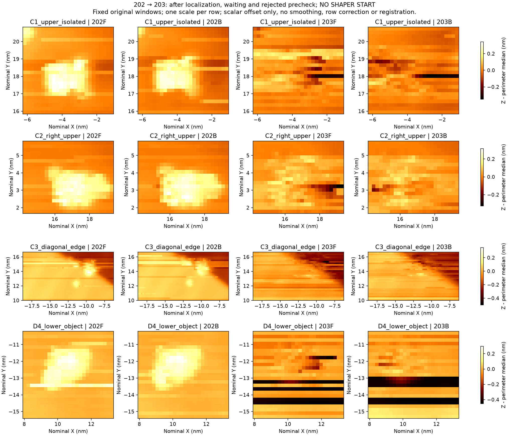
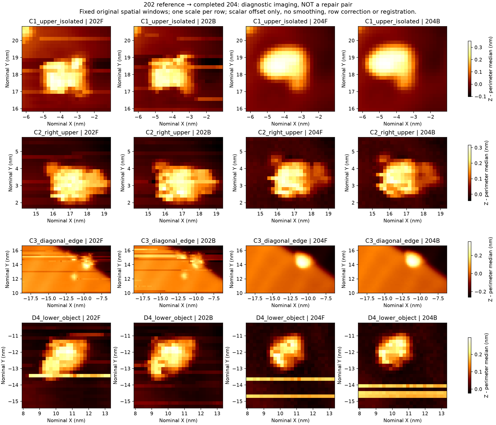
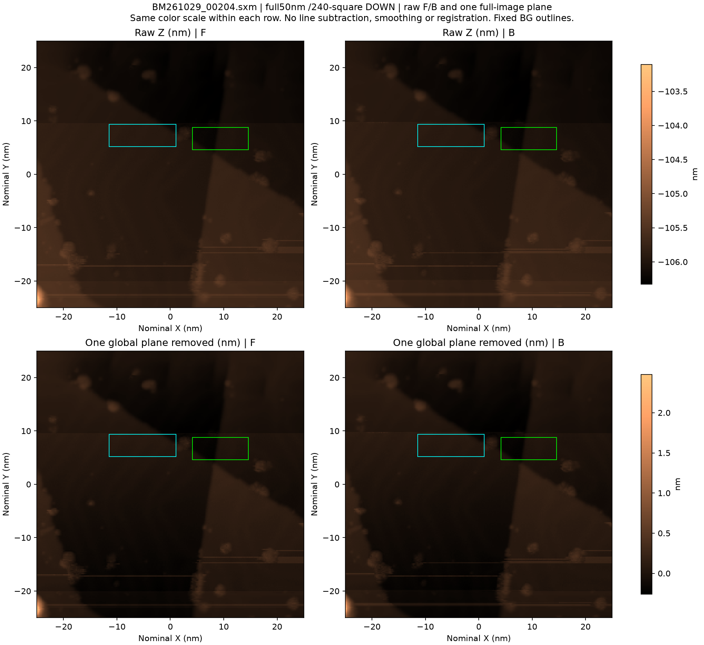

> Portable export of a dated source. Original SHA-256: `b8a928f3380bb755da137ce450c7bf461104c5c4c8a11c15c30f4379ea732765`. Local links were remapped; historical conclusions were not updated. See the package README for the final cutoff.

202 → 203 → 204：定位后功能下降与无新增调理的功能回升

204 的 C1 凸起、C3 斜边及边缘凸起在正反扫中重新清楚，C2、D4 的主对象也可辨。当前证据支持**纳米对象与边界辨识可用、部分区域受限**，不支持继续把203的多区域失能标签直接套在204上。中下部仍有长横线，Y约+9.6至−20nm区域电流噪声更明显；本结论不包含精密高度测量、原子分辨、化学洁净或长期稳定保证。正式来源：[204人工判读](../compare202_204_offline/manual_review.json)。

| 完整帧 | 本机时间（2026-11-03） | 真实角色与观察 |
|---|---|---|
| 202 | 00:36–00:43 | 同条件无调理复扫后形成的限定功能参考：对象和边界可辨，保留局部纹线。 |
| 203 | 01:12–01:19 | 定位移动、静置及I01前检拒绝后的诊断图；C1/C3等远处参照受到长线干扰，可辨性实质下降。 |
| 204 | 01:49–01:57 | 当前状态重新完整观察；多处对象清楚重现，仍有局部横线及噪声。没有新增pulse或TipShaper.Start。 |

三帧均为50×50nm、240×240、DOWN、−1V/100pA、每方向0.912s；六个原始平面均通过345600个float32逐位核验。编号以归档SXM为准，不使用GUI的下一文件编号。

**行动记录与因果边界。** 202之后实际发生定位移动至C2邻域、等待和速度模式恢复。第一次移动到达并已知停止，但最终验证流程遇到文件名冲突；后续恢复不重放XY。I01整形前检因为Z趋势/残差未通过而拒绝，**没有TipShaper.Start**。第一次拟获取204的入口也在Start之前拒绝；实际204来自另一个已完成的扫描事件。相关证据：[移动结果](../../session_02/move_induction_I01/outcome.json)、[I01前检拒绝](../../session_02/induction_I01/outcome.json)、[前次扫描入口拒绝](../../session_02/pre_repair_A02_full/outcome.json)。因此202→203→204是一段诊断状态演化，不能称“诱导已成功”或“修前→修后成功”。

上图四列为202F、202B、203F、203B；四行分别为不同空间区域C1、C2、C3、D4，**上下不是先后时间**。每行统一色阶，各图只减自身边界中位值；无逐行校正、平滑或配准。203的C1/C3远处参照与D4均受到影响，不只是C2一个局部颗粒刮花。C1原参考高对比像素的中位对比从202约246/238pm降至203约20/3pm；这些是固定旧像素的描述值，不能当材料消失或原子高度真值。

这里四列为202F、202B、204F、204B，空间窗口及处理方法不变。204的C1为紧凑清楚凸起，局部平面上的峰高约341/344pm；C3边界及其凸起重新清晰。C2和D4主对象可辨，但形状、位置并不要求与202逐像素不变。D4下方仍有明显横线，未被裁掉或逐行拟合消除。F/B原始Z扣除整体偏置后的RMS依次约42.37、88.99、28.31pm；该量仅辅助说明，并非合格硬门槛。

上排是204完整原始Z的F/B，下排各减一个整幅平面，单位均为nm。下半场、约Y−17和−22.5nm仍有线条，Y约+9.6nm处有全宽偏置边界。全幅对比显示参见[202与204共同对比色阶图](../compare202_204_offline/full_shared_contrast.png)；该辅助图使用已记录的1/99%显示裁切，原始数组不改。完整原图另见[202全图](../../session_02/baseline_segment03_confirm_full/analysis/Z_raw_globalplane_FB.png)、[203全图](../../session_02/after_localization_I01_full/analysis/Z_raw_globalplane_FB.png)，电流像素见[204电流F/B](../../session_02/pre_repair_A02_observed_full/analysis/Current_raw_FB.png)。

**扫描后原生记录不能由一张好图代替。** 203之后约807.5s原生段存在间歇大流和持久Z工作点变化：结束后很早发生约+651pm的窗口中位变化（早期仍含结束定位/松弛混杂），约517s后又有约+168pm变化。最后30秒较安静不能抹去此前异常。随后410–454闭块的562.5s内有38个≥400pA单样点、无≥1nA，未再见同尺度持久阶跃，但电流噪声仍在。来源：[203原生分期](../compare202_203_offline/native_review.json)、[后续静息补充](../post203_rest_blocks410_454_review/review.json)。

204扫描中仍有电流瞬态：原生最低−4.894nA，没有精确匹配软件下限的样点；这不能证明模拟链绝无过载。扫描后已审计**212.05s**，只有结束后约0.49s处一个−409.54pA样点，之后没有≥400pA样点。早期Z持续变化的斜率从约23.3降至8.0pm/s，再到末30秒约+0.148pm/s；末30秒电流−108.56±19.49pA，Z去趋势RMS12.15pm。该形态兼容结束定位后的蠕变/反馈松弛，不能唯一认定原因。204观察长度短于203约517s后那次迟发变化，因此仍不能排除更晚复发。权威来源：[204原生审查](../native204_completed_review/review.json)。

能够支持的物理判断是：有效成像响应具有状态依赖性，而且本次未增加调理操作也能回升。可逆结/尖端状态、扫描与局部物体相互作用、反馈/电子噪声与松弛都仍是候选解释；现有证据没有识别化学物种、单个转移原子或唯一恢复时刻。204较好的对象辨识与扫描中瞬态可同时成立。

**本报告不增加五次任务计数。** 沿用root既有记录：已完成完整操作尝试1/5，尚余4次；成功“脏→修→可用”闭环0。上述三帧均不是新的成功修复。化学洁净不作为本纳米辨识任务的必要条件；项目L0–L4也不因本报告自动升级。203旧JSON误命名的“L1_functional_impairment”只表示独立图像功能下降，[命名澄清](../compare202_203_offline/manual_review_L1_field_clarification.json)已另存，原证据不改。

全部源文件及完整SHA256索引见[source_index.json](source_index.json)。本报告截至204和其已归档212.05s扫描后记录，不代表实时仪器状态。
