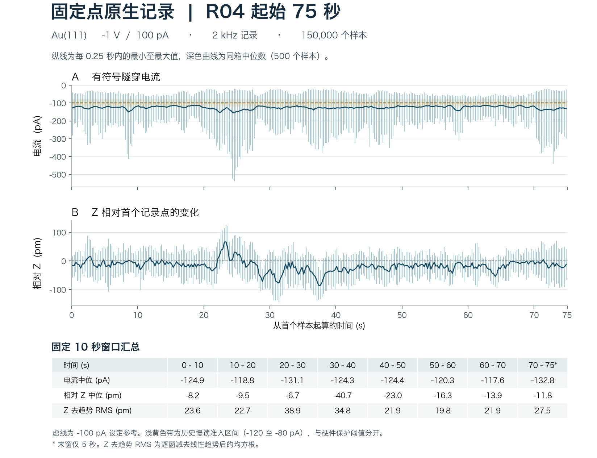

# Au(111) 固定点观测与扫描预检 · 2026-11-03

本记录覆盖 session_02 中 R04 的 289.93 秒固定点原生记录，以及该段开始前的固定点读数。前 75 秒另做了分窗分析。实验员认可了此前 A03 的波动。重新测量时，电流和 Z 的分布已有变化，诊断扫描在发送启动命令前结束。R04 在本记录范围内没有取得新图，也没有实施修针。

## 专家确认的对象

A03 的约 30 秒内，TCP 有符号电流采样均在 −120 至 −80 pA；末约 10 秒为 −112.03 ± 3.05 pA（均值 ± 标准差），Z 线性去趋势 RMS 为 13.73 pm、斜率 −0.103 pm/s。原程序因 RMS 超过 10 pm 止于预检。实验员随后答复“属正常波动，可继续原整形方案”，针对的是这次观察和原定的一次 −0.9 nm Tip Shaper（抬升阶段 +2 V）。此次回复没有给出通用 RMS 上限。A03 的记录仍为未发送整形。 [A03 预检原记录](../au111_continuation_20261103/evidence/session_02/repair_A03/pre30s_summary.json) · [A03 命令核查](../au111_continuation_20261103/evidence/continuation_slow_20261102/A03_no_action_review.json)

上一幅完整图 205 与 204 对照时，C1、C3 参照的可靠辨识受影响，C2 仍可辨。R03 原生记录在本地时间 02:46:45 停止，R04 于 10:48:47 开始，期间约 8 小时 2 分钟缺少连续原生记录，人工操作史也未核实。因此 205 只描述先前状态；R04 固定点数据本身不能回答当前成像功能如何。[205 图像判读](../au111_continuation_20261103/evidence/continuation_slow_20261102/compare204_205_offline/manual_image_review.json) · [R03 终止归档](../au111_continuation_20261103/TERMINAL_ADDENDUM.md)

## R04 的三个观察窗口

读回条件为 −1 V、100 pA、反馈 On/status 2、SafeTip Off，XY 约 (−25, −25) nm。当前温度和针尖材料没有独立确认。前两项使用顺序 TCP 读数；第三项使用原生 Data Logger。原生前 75 秒覆盖扫描预检时段，三项不能当作独立、同带宽的重复测量。

| 窗口 | 观察结果 | 判读 |
|---|---|---|
| 原生段开始前，约 30 s 固定点 | 199 个读数，I 为 −124.42 ± 6.78 pA，65 个落在 −120 至 −80 pA。末约 10 s 的 Z 去趋势 RMS 为 35.58 pm，斜率 −3.68 pm/s。 | 与 A03 获认可的起点不同。此窗口只采集读数。 |
| 诊断扫描启动前，首个完整 5.05 s 窗口 | 36 个读数，范围 −134.53 至 −117.29 pA，均值 −125.65 pA。逐点条件 [−150, −50] pA 满足，均值低于预定下限 −125 pA 约 0.65 pA。 | 均值准入范围为 [−125, −75] pA。程序保留整个窗口，未发 Scan.Action Start。该条件用于流程准入，不能独立判坏针。 |
| 原生前 75 s，块 1–6 | 2 kHz，共 150,000 行。I 为 −127.56 ± 46.07 pA，范围 −537.35 至 −20.45 pA。有 80 个样本的电流绝对值 ≥400 pA。整段 Z 去趋势 RMS 为 29.64 pm。 | 80 是样本数，不能直接当成 80 次事件。整段原生 RMS 与 10 s TCP RMS 使用不同带宽和时间窗。 |

当时界面显示 `log Current`。按本机 Nanonis Mimea 帮助《Z-Controller Configuration》第 5 节和《Z-Controller》第 3 节，log 模式控制绝对值的对数，Z 面板以绝对电流显示读数。此处原生每行的 Z Control 和 Z SafeTip 均等于 |Current|；|Current| 的算术均值为 127.56 pA、几何均值为 119.52 pA，Z Error 的均值为 +3.53 pA。这些数据不足以反推出 Z Error 的缩放、滤波或实时控制误差。

**计数截止至本次前 75 秒核对。** 五次完整图像对照尝试中，历史已完成 1 次，剩余 4 次。严格的“明确诱导变坏 → 修复 → 成像可用”闭环累计 0 次。延续同一历史 episode，累计已记录脉冲 3 次，Tip Shaper Start 0 次；本次新增扫描启动、完整图、诱导和修复动作均为 0。

[结构化数值、分窗统计及原始来源散列](./observations.json) · [30 s 与 5 s 的全部 TCP 样本](./tcp_windows.json)

## 记录终点

10:53:37 主动停止本次 Data Logger。两次独立读回确认同一停止时刻，反馈保持开启，−1 V / 100 pA、SafeTip Off，扫描未启动。全部 24 个 DAT 块（每通道 579,860 行、0.5 ms 间隔）均核验了双读哈希、行数与六通道有限值。全段电流均值 −128.06 pA，范围 −537.35 至 −16.70 pA。整段未执行扫描、脉冲或整形，以上计数不变。当前成像表现仍待新完整图验证。[终态统计与各块散列](./terminal_observation.json)

