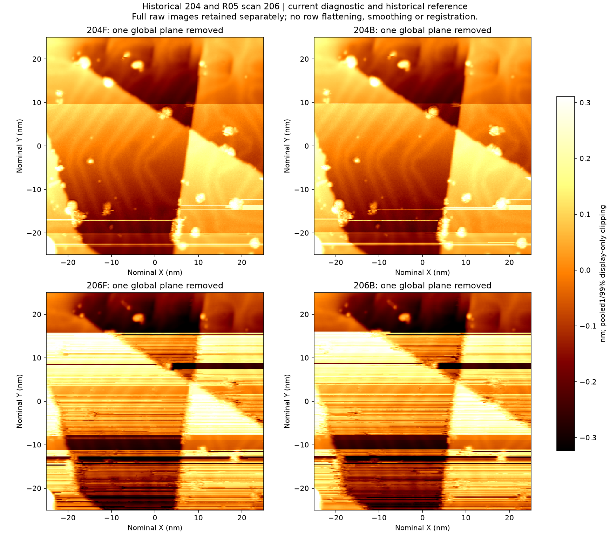

# Au(111) 完整诊断图 206

2026 年 11 月 3 日 11:07:55 至 11:15:14，按实验员确认的条件在原位置向下扫描。**本帧能辨认上部孤立颗粒及主要台阶。中下部的成片横纹使多个颗粒的轮廓和高度难以可靠比较。**

## 扫描记录

| 项目 | 实测或读回 |
|---|---|
| 样品、区域 | Au(111)，中心 (0, 0) nm，50 × 50 nm，角度 0° |
| 图像 | 240 × 240 像素，向下，正反方向各 0.912 s/行，实际 438.8 s |
| 结和反馈 | −1 V，100 pA，log Current 反馈开启，SafeTip 关闭 |
| 开扫前 | 首个 5 秒窗口 37 点，平均 −119.54 pA。原扫描均值区间为 −125 至 −75 pA。实验员接受此前观察状态后，操作方根据原生分窗统计为本次诊断选取 −141 至 −75 pA。两套门槛在本次均通过。整形判据另计。 |
| 数据核验 | 原生 SXM 和 TCP 独立采集的 Z、电流与锁相 Y 正反扫共 345,600 个 float32 值逐位一致。当前温度未取得独立读数。 |

## 图像判断

上排为历史参照 204，下排为本次 206。左列正扫，右列反扫。四幅图分别减去一个整体平面，统一色标使用合并数据的第 1 至 99 百分位。原始高度保存在 SXM 中。两帧之间存在原生记录空档，期间人工操作史未知。

- 上方孤立颗粒 C1 在 206 的两个方向上都有紧凑轮廓，较 205 更容易辨认。
- 从 Y 约 +16 nm 开始可见多道长横纹。斜台阶 C3 的走向仍可辨，但边上颗粒被横纹切割。右侧 C2 和下方 D4 的部分轮廓也与横带混在一起。图像受影响的范围超出了原先标出的局部刮痕。
- 正反扫同坐标高度差去除均值后的 RMS，204 为 28.31 pm，205 为 60.58 pm，206 为 66.10 pm。该统计描述两个方向的一致性。判读同时考虑正反扫中都出现的条纹和独立参照物的可辨程度。
- 这些观察支持将 206 记录为本轮成像功能部分受损的诊断图。条纹可与扫描期间发生的结状态或反馈响应变化相容，当前数据无法确定吸附物成分、双尖或具体材料转移机制。

[204 与 206 的局部正反扫](./figures/204_206_objects.png) · [205 与 206 的局部正反扫](./figures/205_206_objects.png)

## 原生电流与图像位置

同步记录以 2 kHz 采集六个通道。按计数器可明确归入扫描的 438.08 s 共 876,160 个样本，平均电流 −100.35 pA。22 个样本的电流绝对值达到 1 nA，聚为 14 组，其中两组达到 4 nA。名义第 44–45 行附近的峰为 −9.71 nA，第 85–86 行附近的峰为 −9.92 nA，均按首行为第 1 行计。全段没有样本等于此前记录的软件量程底值。

在第 85–86 行附近，−9.92 nA 后两个样本依次为 −1.49 和 −0.119 nA。邻近 1.5 ms 内，Z 读数抬升约 0.28 nm。图像正扫该行带的最负像素为 −1.65 nA。每像素名义采样时间为 3.8 ms，原生数据每 0.5 ms 一个样本。两者可以在慢扫行上互相印证，尚不能锁定同一瞬间、列及扫描方向。较早的横带在此之前已出现。

[像素电流正反扫](./figures/206_pixel_current.png) · [原始 SXM](./BM261029_00206.sxm) · [分段统计与采集条件](./observation.json) · [原生文件校验清单](./native_index.json)

11:15:46 停止本段记录。两次读回确认同一停止状态，全部 39 块、每通道 973,120 行已封存。最后读回扫描空闲、−1 V / 100 pA、反馈开启和 SafeTip 关闭。该段包含一次完整诊断扫描，调理动作数为零。累计完成 1/5 次完整尝试，严格成功 0 次，剩余 4 次。
